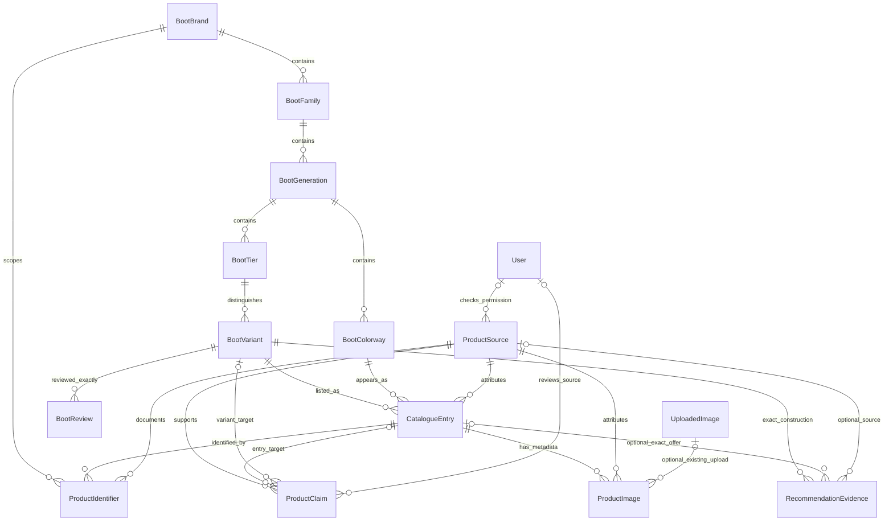

# Data D1 — Product schema and source registry

Date: 24 October 2026. Scope: schema, source registry, validation and secure curation interfaces. No D2 import job, crawler, automated collection, production deployment or GitHub push.

## Existing implementation audit

Inspected the Prisma schema and twelve prior migrations; catalogue, details, comparison, review aggregates, recommendation eligibility, seed/import scripts, moderation APIs and private image storage. Read the full-audit, remediation and Phase 4.1/4.2 reports. Their historical completion statements are not evidence of current remote infrastructure readiness.

Before D1, the guarded development database contained **8 catalogue entries, 1 user and 0 reviews**. All eight entries remain explicitly identified as samples. The database-backed catalogue already worked; there was no product/source administration interface. The existing `/admin` is a moderation dashboard, not a product editor.

| Property | Before D1 | Existing location → D1 mapping |
| --- | --- | --- |
| Brand | EXISTS BUT INCOMPLETE | `BootBrand.id/name` retained; optional unique slug, website, active/archive status and UTC registry timestamps added |
| Family | EXISTS AND SUFFICIENT | `BootFamily.brandId/name`; no duplicate family table |
| Generation | EXISTS AND SUFFICIENT | `BootGeneration.familyId/name` |
| Tier | EXISTS AND SUFFICIENT | `BootTier.generationId/name`; manufacturer-specific labels remain data, not a global tier enum |
| Exact construction/outsole variant | EXISTS BUT INCOMPLETE | `BootVariant.tierModelId/generationId/surface`; add manufacturer designation and construction note; broaden catalogue category constraint |
| Colorway | EXISTS BUT INCOMPLETE | `BootColorway.generationId/name/swatch`; add optional `colorNames[]`; retain swatch compatibility |
| Product listing | EXISTS AND SUFFICIENT | `CatalogueEntry` joins a variant and colorway within one generation; existing composite FKs and unique pair retained |
| Manufacturer SKU | MISSING | New `ProductIdentifier` → exact entry, brand, regional scope, source and source URL |
| Technical specifications | REQUIRES REFACTORING | Existing `CatalogueEntry.specifications` JSON retained for compatibility; new observations go through validated `ProductClaim` records |
| Product photos | MISSING at product level | Reuse `UploadedImage` storage/ownership/deletion; new `ProductImage` metadata association, not another upload system |
| Publication lifecycle | EXISTS BUT INCOMPLETE | `CatalogueEntry.published` retained; add lifecycle status, stable-URL lock, version and timestamps |
| Product source registry | MISSING | New `ProductSource`; nullable primary `CatalogueEntry.sourceId` for honest legacy unknowns |
| Specification provenance | EXISTS BUT INCOMPLETE | Legacy URL/observed date lacked a registry/reviewer; new claims retain source type, basis, observation and review decisions |
| Verification status / last checked | MISSING as relational workflow | Claim/image verification states, review timestamps, source check/authorization timestamps and audit actor |
| Offers and prices | EXISTS BUT INCOMPLETE | Reuse `RecommendationEvidence` PRICE/AVAILABILITY; add relational source, exact-entry composite FK and country scope |
| Surface safety evidence | EXISTS AND SUFFICIENT | Existing separately approved `RecommendationEvidence.SURFACE`; never inferred from normalized outsole or marketing text |

No real SKU, manufacturer specification, endorsement, price, image permission or source authorization was invented or seeded.

## Models and relationships

Four new tables: `ProductSource`, `ProductIdentifier`, `ProductClaim`, `ProductImage`. Three small workflow/type enums. Existing identity, review, evidence, upload, user and audit entities are reused.



The two claim target relations are **exclusive**, enforced by PostgreSQL, not simultaneous optional targets. Image location is likewise exactly one existing upload or external URL.

### Identity policy

- Internal IDs remain independent of display names. New brand/entry IDs are random UUIDs; registry children use existing Prisma-generated IDs. Existing IDs and public slugs are unchanged.
- Tier, generation, outsole category and colorway are separate dimensions. FG and AG are separate variant records. Identical tier/outsole labels do not force identical construction IDs.
- Sharing a variant across colorways is an explicit curation decision requiring construction evidence. D1 does not infer this from appearance or SKU. Existing curated variant relationships are preserved; reviews still aggregate exactly that variant.
- SKU identity is `(brandId, region, value)`. Trim and NFC-normalize values, preserve manufacturer case. `UNSPECIFIED` is unknown scope; it is not `GLOBAL`. Different brands/regions may reuse an identifier. Case-only matches on other entries produce a warning, never an automatic merge.
- `ProductIdentifier.brandId` is deliberate denormalization for the unique key. Insert/update ancestry checks and parent-change guards prevent drifting it to another manufacturer.
- The composite generation FKs prevent cross-generation variant/colorway listings. Existing unique `(outsoleVariantId,colorwayId)` prevents duplicate listings.
- Normalized brand-name uniqueness uses a PostgreSQL expression index over lowercase, trimmed NFC text. Nullable legacy slugs are not guessed from names; new brand creation requires a unique slug.

### Specifications and surface evidence

`ProductClaim` stores a validated attribute/value observation with exactly one entry or explicit construction target. Attributes include upper material/technology, outsole construction, studs, closure, collar, tongue, manufacturer fit description, surface designation, construction, weight, release date and additional features.

Text is bounded. Weight requires a positive numeric amount, `g`/`oz`, size and size system; a measured weight also needs its method. Dates are real ISO calendar dates. Feature lists have bounded item/count limits. Both Zod and the SQL `bootverse_valid_claim` function enforce these shapes; unknown attributes are rejected. Missing claims mean unknown, never a made-up value.

`basis` distinguishes reported, measured, community and expert observations. Source type further distinguishes manufacturer/retailer reporting. An administrator checking a report does not turn marketing language into a laboratory measurement.

Catalogue categories now support `FG/AG/SG/TF/IN/MG/OTHER`, with SQL NULL for unknown. Manufacturer outsole wording has its own optional field. Finder's supported surface contract and separately approved exact-variant safety evidence remain unchanged. `MG/OTHER` catalogue labels do not become Finder eligibility or artificial-grass approval.

## Source registry and provenance

`ProductSource` records name, type, public HTTPS base URL, optional manufacturer brand, access method, authorization status, restrictions, permission notes/reference, checker, check timestamps, status and version. It contains **no credential fields**.

Types are `MANUFACTURER`, `RETAILER`, `PRODUCT_FEED`, `AFFILIATE_FEED`, `MANUAL_RESEARCH`, `COMMUNITY`, `OTHER`. A type describes origin; it does not assert authorized access. `GRANTED` and `NOT_REQUIRED` require a written rationale/reference and server-recorded check time. `UNKNOWN/REQUESTED` remain explicit warnings; `DENIED` or archived sources cannot supply new records. Once referenced, a source cannot silently change origin, manufacturer or type.

URLs are validated as HTTPS without credentials, obvious private/local addresses or secret query parameters. D1 never fetches these URLs: no new SSRF path, scraping or third-party image download. D2 must separately implement destination/DNS/redirect checks if it introduces network retrieval.

Every new claim/SKU/image/offer has a source reference and source URL; every new entry requires a primary source. Existing entries retain NULL sources rather than invented provenance. Observations are immutable through these APIs: correcting a value means adding an observation and explicitly reviewing the conflict. Decisions use optimistic versions, server actor/time and the existing `ModerationAction` audit trail.

| Current claim/image state | Allowed next states |
| --- | --- |
| UNVERIFIED | PENDING_REVIEW, REJECTED |
| PENDING_REVIEW | VERIFIED, CONFLICTED, REJECTED |
| VERIFIED | PENDING_REVIEW, CONFLICTED |
| CONFLICTED | PENDING_REVIEW, REJECTED |
| REJECTED | PENDING_REVIEW |

New observations always start UNVERIFIED. VERIFIED needs explicit source-check confirmation and a decision note. Incompatible verified values cannot both be approved within a shared variant/entry scope. Variant-level decisions serialize on the variant row. A conflict must be resolved through re-review; neither import nor publication promotes evidence automatically.

Public technical projection currently supports the existing upper/weight/release-date fields. It only displays applicable, unambiguous, checked claims from active, non-denied sources. Source name/type/basis are shown with “not independent scientific certification.” Conflict, unsafe data, source revocation or bounded-query overflow becomes unknown. Other new attributes are available through admin inspection for later enrichment UI.

Legacy specification JSON is retained and explicitly labeled **“Legacy attributed specification; registry verification is not recorded.”** Its existing source parser remains in force. When a D1 observation exists for that attribute, stale legacy JSON cannot override a conflict or rejected/unverified replacement.

## Image metadata and offers

`ProductImage` stores entry, source URL, attribution, permission/license evidence, alt text, ordering, primary flag, status and timestamps. An admin can reference their own ready published upload, or register an external HTTPS URL. Client object keys/paths are rejected. A partial unique index permits one primary image per entry. Verification requires documented permission; no actual rights verification is fabricated. Existing upload deletion cascades metadata; the existing storage deletion queue remains authoritative. D1 does not render newly registered product photos or bypass private upload serving; that belongs to the enrichment/editor work.

Pricing reuses the existing evidence model, including its approval/freshness/parser rules. New offer creation writes an exact-entry PRICE observation and optionally size-scoped AVAILABILITY in one transaction. Source, amount/currency, observation/expiry, country and size context are retained. Approval defaults false and cannot be supplied by this API. Composite FK `(entryId,variantId)` prevents a price crossing variants. SQL checks also require a linked JSON entry ID to exist, be a string and agree with that FK.

Only valid existing payload references are backfilled to relational entries. Unknown retailer/source/region is left unknown. Public sourced offers label their country or “Region not recorded”; archived/denied registered sources are excluded. Finder has no country selection, so country-specific PRICE/AVAILABILITY cannot influence its regionless decisions. No automated pricing collection or new approval shortcut was added.

## Publication and quality rules

| Current product state | Allowed next states through admin service |
| --- | --- |
| DRAFT | PENDING_REVIEW, REJECTED |
| PENDING_REVIEW | DRAFT, PUBLISHED, REJECTED |
| PUBLISHED | ARCHIVED |
| ARCHIVED | PENDING_REVIEW |
| REJECTED | DRAFT |

Publication requires valid identity relationships and an available primary source. Unknown tier labels, invalid outsole codes, unresolved/conflicting claims, inactive brands, unavailable checked-claim sources or overflowing review limits block publication. Missing optional technical fields do not.

Quality reports separate `errors`, `warnings`, `missingOptional` and `ready`. Missing SKU/licensed image, unknown outsole and unknown source permission are warnings. Case-only SKU candidates are flagged. Exact scoped duplicate identifiers are blocked by SQL. Full specifications, photography and a SKU are not prerequisites for publishing an otherwise valid partial listing.

Public queries retain the indexed `published=true` predicate. A lifecycle trigger keeps that legacy boolean consistent with status. First publication permanently locks the public slug and variant/colorway/generation identity, including after archival.

**Compatibility boundary:** trusted legacy import/SQL writers can still write `published`; that bridge intentionally preserves existing seed/operational behavior and does not run admin readiness checks. Public APIs never accept that field. Before removing this bridge in later approval work, migrate every trusted writer to the lifecycle service, verify no remaining boolean writes, then remove it in a separate migration. Database write credentials must remain privileged; direct SQL is not an end-user interface.

## Service/API interfaces

All routes below are server-only, ADMIN-only, no-store; mutations reuse the existing origin/JSON/body-size/rate-limit guard (60 product-data mutations per 15 minutes). The active role is locked and rechecked in the transaction. Unknown fields are rejected. Successful mutations are audited; stale versions and duplicate identities return 409.

| Endpoint | Methods / purpose |
| --- | --- |
| `/api/admin/product-brands` | POST register a brand without product claims |
| `/api/admin/product-sources` | GET paginated search; POST source registration |
| `/api/admin/product-sources/[id]` | PUT versioned update/archive/permission decision |
| `/api/admin/products` | GET paginated draft/status/search inspection; POST attributed draft |
| `/api/admin/products/[id]` | GET ancestry, metadata and quality; PATCH versioned publication transition |
| `/api/admin/products/[id]/records` | POST `{kind,data}` for identifier, claim, image metadata or unapproved offer |
| `/api/admin/product-claims/[id]` | PATCH versioned source-check decision |
| `/api/admin/product-images/[id]` | PATCH versioned source-check decision |

There is no bulk importer, crawler, scheduler or full product editing dashboard in D1. Existing moderation UI is preserved. List endpoints paginate 25 records, pages 1–1000, search length 100. Inspection bounds identifiers/images/claims and reports overflow instead of silently approving incomplete data. Raw SQL uses bound parameters.

### Synthetic contract example only

```json
{
  "entryId": "synthetic-entry-only",
  "sourceId": "synthetic-source-only",
  "sourceUrl": "https://example.test/fixture",
  "attribute": "weight",
  "value": { "amount": 200, "unit": "g", "size": "9", "sizeSystem": "UK", "method": "Synthetic test method" },
  "basis": "MEASURED",
  "observedAt": "2026-10-01T00:00:00Z"
}
```

These are deliberately synthetic test values, not product specifications or live catalogue data. Clients do not submit calculated status, reviewer or authorization actor IDs.

## Migrations, preservation and recovery

1. `20261024010000_product_sources`: atomic expansion, four tables, enums, optional registry fields, identity/source FKs, bounded claim checks, scoped uniqueness, publication/SKU guards and conservative visibility/offer-reference backfills.
2. `20261024020000_offer_entry_payload_guard`: narrow additional CHECK for missing/null JSON entry IDs. PostgreSQL CHECK accepts NULL results; a regression test exposed that loophole. This second migration preserves the history of the already applied local expansion.

No table/column/data removal, product merge or remote migration. The old outsole CHECK is replaced transactionally with a broader constraint. Duplicate normalized brand names abort the expansion before changing schema. Existing published entries become PUBLISHED and URL-locked; private entries remain DRAFT. New legacy registry timestamps mean “registered during migration,” not manufacturer release or original creation time.

Migration tests create owned random local databases, run the prior twelve migrations, insert clearly synthetic legacy records, rehearse both D1 migrations and verify failed-preflight atomicity, preservation, old boolean writes and database-level rejection. Full API tests use a separate random migrated database and temporary S3 bucket/captured SMTP. Only these owned disposable fixtures are removed.

The existing **localhost** development DB was backed up to ignored `.local/backups/d1-before-20261024T0027.dump` (private directory 0700/file 0600). Its archive manifest was checked and restored successfully into an owned temporary database with the original 8 products/1 user/0 reviews/12 migrations. Identity, slug, visibility and legacy-specification hashes matched after the first expansion. Final state is recorded in the verification ledger below.

Remote deployment procedure, **not executed**:

1. Explicitly approve the target and reconcile its actual schema/history; do not assume the configured Neon target has the twelve prerequisite migrations.
2. Back up and restore-rehearse; preflight normalized brand duplicates, linked offer payload/FK mismatches, constraint validity and migration checksums. Resolve conflicts deliberately, never auto-merge/delete.
3. Rehearse on an isolated copy with representative data. Estimate table locks/backfill/index duration; the current transactional indexes are suitable for the measured small catalogue, not an unmeasured million-row rollout. Use a reviewed concurrent-index/batched plan if size requires it.
4. Apply reviewed migrations using separate migration credentials before deploying readers; regenerate the Prisma 7 client. Verify migration status/checksums, constraints/triggers, schema drift and old/new query behavior. New readiness requires the latest D1 marker.
5. Smoke-test publication, catalogue, comparison, reviews and Finder. A failed transaction preserves the old schema. For an application rollback after success, keep the additive schema and deploy the previous compatible reader/writer; do not drop new tables containing observations. Restoring a real database needs a separate approved recovery window and reconciliation of any newer writes.

The tested recovery path is retain-expanded-schema compatibility plus isolated backup restoration; no destructive down migration was executed on existing data. Neon, AWS, credentials and real product records were not modified.

## Verification ledger

Final checks and limitations are recorded here rather than inferred from the existence of tests. Command logs for this local session are under `/tmp/bootverse-data-d1-20261024/`; that scratch directory is not a durable CI artifact.

| Check | Result / evidence |
| --- | --- |
| `npx --no-install prisma validate` / client generation | PASS, installed Prisma 7.10.0 |
| `npm run typecheck` | PASS, actual generated Next route types remain checked |
| `npm run lint` | PASS, no warnings/errors |
| `npm test` | PASS, 247 tests in 27 files |
| Production `npm run build` | PASS on Next 16.4.3; final compile 2.4s, TypeScript 2.3s, routes generated successfully |
| `BOOTVERSE_BENCHMARK=1 npm run test:platform:local` | PASS, **91/91**, 0 failed/cancelled/skipped; includes legacy migration rehearsals, D1 regressions and previous platform features |
| Browser `catalogue`, `profile`, `admin` | PASS: database filters/sorting, exact comparison, profile timeout/recovery, moderation filters/error recovery |
| Browser `data` | PASS: admin source/claim workflow, escaped text, source revocation, keyboard source link; no horizontal overflow at 320/768/1024/1440 px |
| Visual inspection | PASS, local synthetic detail screenshots at mobile/desktop; existing unknown/image/review states preserved |
| Test sensitivity | PASS: deliberately allowing direct publication caused the publication test to fail; original code restored |
| `npm audit` / `npm audit --omit=dev` | PASS, 0 vulnerabilities after compatible patches described below |
| Prisma `migrate status` on guarded local profile | PASS, **14 migrations**, database schema up to date |
| `npm run db:verify -- --env-file .local/development.env` | PASS, 35 tables, 14 completed migrations, 60 FKs, 53 checks, 61 unique indexes; checksums/triggers/drift all clear |
| Existing development DB | PASS: still 8 entries/1 user/0 reviews after both migrations; identity, slug, publication and legacy-specification hash unchanged |
| Local Docker build, `linux/amd64` | PASS with frozen `npm ci`, Prisma generation and standalone production build; image kept local |
| Local container smoke | PASS: live 200, login 200, icon 200; readiness safely 503 without DB credentials. Temporary container removed |
| Secret/env check | PASS: seven actual configured secret/credential values absent from 318 nonignored source files and 46 client assets; private env files untracked |
| Production email, Neon migration, AWS/IAM, full production load | NOT TESTED / not authorized in D1 |

Earlier failures were not hidden: a test helper overwrote an explicit hostile Origin and was corrected; a new offer test incorrectly searched by slug instead of supported display text and was corrected. A sandboxed build stalled and was stopped; an integration run started too early failed to connect and is not counted as passing. The escalated local build succeeded. The long unbroken source-name browser test initially failed at 320px; scoped wrapping fixed it and all four viewport assertions passed. The missing JSON entry-ID assertion failed before the additional CHECK, then was rerun with the fix. These are distinct from final successful runs.

The first backup invocation included application URL options unsupported by libpq and produced an empty file; no migration ran until a retry using explicit libpq environment fields produced a valid private dump. The empty file was removed. An initial broad secret scan matched a credential-free local SMTP endpoint in examples/documentation; those were inspected as non-secret configuration, then actual credential-bearing values were checked separately with zero matches. Docker's amd64 container ran under emulation on the arm64 development host; the smoke result is functional, not a native-throughput benchmark. All owned QA servers/databases/buckets/mail captures were cleaned up.

### Security/dependency maintenance

An audit during this task found one Critical and six Moderate findings in the then-installed dependency graph. Applied compatible security patches: Next/eslint-config-next **16.4.3**, Nodemailer **10.1.4**, fast-uri **3.1.9**. Existing Auth.js architecture and the small native-glob adapter are preserved; its version-scoped override was updated and compatibility tests pass. SMTP's nested Nodemailer follows the same patched version. No force audit upgrade or authentication replacement.

Primary release references: [Next 16.4.3](https://github.com/vercel/next.js/releases/tag/v16.4.3), [Nodemailer 10.1.4](https://github.com/nodemailer/nodemailer/releases/tag/v10.1.4), [fast-uri 3.1.9](https://github.com/fastify/fast-uri/releases/tag/v3.1.9). Audit results are a dated dependency check, not a complete security certification. Existing ESLint 9 support-lifecycle notices remain a future tooling-upgrade task.

## Query limits and performance

Indexes cover exact identity/FKs, source references, claim target/status/attribute, image ordering, publication lists and entry/region/offer observation. Public projection fetches bounded source metadata; no credential, user email, private measurement or image binary is added. Query overflow withholds specification conclusions rather than selecting a biased first subset. Admin lists paginate; draft inspection is bounded and explicitly blocks overflow.

The synthetic 1,000-claim EXPLAIN probe verifies the scoped indexes exist and reports the equivalent bounded lookup. It is not the complete Prisma-generated query or a promise about all production data distributions. Recommendation HTTP benchmarks use owned 7-variant/0-review and 100-variant/2,000-review datasets at concurrency 4, 32 measured requests plus warm-up. Final measured values belong to the final-run section below. No speculative caching or new client bundle was introduced.

| Final synthetic measurement | Result |
| --- | --- |
| 7 variants / 0 reviews | p50 7.98ms, p95 10.31ms, request error rate 0 |
| 100 variants / 2,000 reviews | p50 70.76ms, p95 81.64ms, request error rate 0 |
| 1,000-claim bounded lookup probe | execution 0.009ms, planning 0.169ms; LIMIT plan, scoped index presence checked |

These localhost measurements do not instrument total Prisma SQL count or app RSS, and do not model production network latency/load.

## Changed file groups

- `prisma/schema.prisma`, the two D1 migrations: additive registry, identity/provenance/lifecycle/offer constraints.
- `src/lib/product-data/{validation,service,projection}.ts` and unit tests: strict contracts, quality, secure services and public provenance projection.
- `src/app/api/admin/product-*`, `src/app/api/admin/products/**`: eight route files; readiness marker in `src/app/api/health/ready/route.ts`.
- `src/lib/boots/{types,labels,product,service}.ts`, recommendation evidence/types/service: broader catalogue labels, bounded source reads, offer region policy; Finder safety stays separate.
- `src/components/product-{attribute,offers}.tsx`, `src/app/globals.css`: source/legacy/region labels and long-text wrapping. Existing detail/comparison components reuse these projections.
- `tests/product-{data,migration}.integration.ts`, main integration helper, browser regression runner/helpers and focused unit fixtures: new regressions and the hostile-Origin test-helper correction.
- `scripts/verify-database.mts`, `package.json`, lockfile, native-glob adapter comment: schema verification and audited compatible dependency patches.
- README, this report and `tasks/plan.md` / `tasks/todo.md`: scope, contracts, actual checks and remaining work.

## Remaining limitations and D2 readiness

D1 is **ready as the local foundation for D2**, with the checks above passing. This is not production deployment approval or a claim that real product data has been curated. D2 may add CSV/authorized-feed adapters and idempotent normalization/upserts on these source/scoped-identity contracts; it must not bypass validation or verification. Human curation still decides whether colorways share construction. Registry/source existence does not make existing samples real products.

Still deferred: product editing/bulk approval UI, full public rendering of all new specification fields/product images, image-license investigation, automated permission/source refresh, price collection, source-specific import identifiers/idempotency policy and scheduled updates. Offers remain validated evidence JSON with exact relational scope, rather than a replacement pricing subsystem. D1 has no offer-approval endpoint.

Legacy JSON specifications, nullable source fields and trusted boolean writers need a later audited conversion before removal. D1 does not auto-verify or republish them. The current source URL checks must not be reused as a complete fetch/SSRF policy. Country/region scope is explicit; Finder needs a separate location contract before using regional offers. Production SMTP, verified TLS/proxy configuration, backup operations, IAM and remote schema reconciliation remain release gates described in the Phase 4 reports.

Skills actually loaded/applied: using-agent-skills, api-and-interface-design, test-driven-development, incremental-implementation, planning-and-task-breakdown, performance-optimization, security-and-hardening, code-review-and-quality, deprecation-and-migration, frontend-ui-engineering, playwright, git-workflow-and-versioning and ponytail. No skill use is claimed for merely listed but unread skills.

D2 has not been started. No deployment or push was performed.
