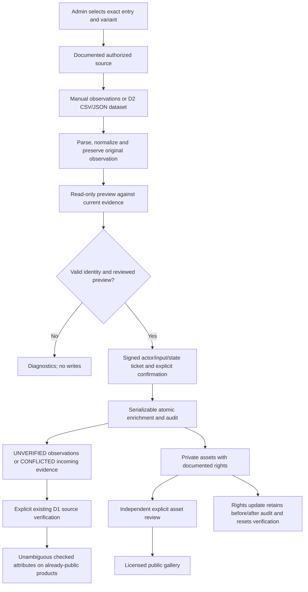

# Data D3 — Product enrichment, evidence and licensed assets

24 October 2026. Implements local, administrator-managed enrichment; no D4/D5, remote migration, live collection, automatic product publication, AWS provisioning, deployment or GitHub push.

## 1. Actual D1/D2 integration assessment

D1 already supplied normalized brand/family/generation/tier/outsole/colorway identity, source permissions, immutable claims, asset metadata, publication guards, scoped offers and explicit evidence decisions. D2 supplied CSV/JSON parsing, identity matching, draft imports, signed read-only previews, transactional idempotency, source-record mappings and batch reports. Their existing code was inspected rather than rebuilt. The D2 report was missing at D3 start; it is now documented in `DATA_D2_IMPORT_PIPELINE_REPORT.md`. Its outstanding browser import regression has now passed, including the guest redirect.

The uncommitted D2 work was preserved on `codex/data-d2`; D1's local checkpoint is `1bf885a`. Neither this branch nor the new work was pushed. Existing development DB is preserved at **8 sample catalogue entries, 1 user, 0 reviews, 14 applied migrations**. Native local migration status exits 1 with D2 and D3 pending. This is an explicit activation gate, not a successful status check. No Neon migration/status write or persistent local migration occurred during D3.

## 2. Architecture and workflow

Reuse `ProductClaim`, `ProductImage`, `UploadedImage`, `ProductImportBatch`, `ProductImportRow` and `ModerationAction`. No parallel observation, storage or batch tables. Batches have purpose IMPORT or ENRICHMENT. Business logic lives in `src/lib/enrichment`, separately from React and HTTP handlers.

Publication remains separate. The enrichment service never changes IDs, slugs, ancestry, surface eligibility, existing claim values, product visibility or recommendation scores.

## 3. Contracts and specifications

Direct request: `{sourceId, rows:[{entryId, variantId, sourceUrl, observedAt, sourceRevision?, specifications, images}]}`. Every row targets an existing exact entry/variant. Maximum 1,000 rows, 30 observations and eight asset references per row, subject to server byte/storage limits. Observation properties are attribute, value, basis and optional notes; source/target/status/reviewer cannot be overridden inside them.

Feed request: `{sourceId, feed:{format:"CSV"|"JSON", content, mapping}}`, using D2's version-1 products format, identity fields and target→CSV-header mapping. Match requires an existing source-record mapping or manufacturer/region/case-sensitive SKU plus consistent full identity. New/ambiguous/changed-tier/changed-outsole identities are rejected; enrichment does not create a product. Offers are rejected here: prices/stock retain their existing separately attributed offer workflow.

Supported attributes: upper material and technology, surface texture, construction, toe-box and midfoot construction, heel structure, collar, tongue, closure, outsole construction, stud configuration, soleplate material/technology, manufacturer surface designation/guidance, normalized outsole category, contextual weight, release date and bounded additional features. Generation/tier/colorway/SKU remain identity/identifier entities, not silently editable technical text.

Normalization preserves terminology and the original value, with an explicit change list. Text trims/NFC-normalizes/collapses whitespace; comparison ignores case. Known outsole aliases reuse D2; e.g. AG-Pro becomes AG while the original wording remains recorded. This is a label normalization, never artificial-grass safety approval. Weight accepts g/grams, oz/ounces and kg/kilograms, normalizes to grams with up to 12 significant digits, requires sample size/system, and requires method when independently measured. Unsupported/malformed values fail validation. No internal width is inferred.

Missing attributes have no observation. Explicit JSON null becomes the validated `{unknown:true}` observation; it is excluded from completeness/public values. Unknowns are not replaced with plausible specifications.

## 4. Evidence and verification

Claims retain exact target, source registry ID, URL, observation UTC timestamp, revision, basis, notes, original observation, normalization changes, fingerprint, batch row, status, reviewer and decision history. Source type distinguishes manufacturer/retailer/community origin; basis distinguishes report, measurement, community and expert opinion. A source-checked manufacturer report remains a manufacturer report, with a visible non-certification caveat.

New observations are UNVERIFIED; real contradictions are CONFLICTED. Existing D1 transitions and explicit source-check confirmation remain authoritative. Immutable observations are corrected by adding another observation, not editing their values. Unknown/denied/archived source access cannot enter this workflow; manufacturer source/brand association is checked. Live provider credentials are neither requested nor stored in provenance.

## 5. Deterministic conflicts and deduplication

- Compare overlapping entry/construction evidence and incoming observations; preserve existing values and both references in private row reports.
- Weight context compares size label, size system and method. Different contexts are not contradictions; no size-system conversion is guessed. Ounces/grams are numerically compared with a 0.000001-g floating-point tolerance, not a claimed measurement accuracy.
- Same-context unequal weights or different text/feature values are conflicts. Explicit unknowns establish no contradiction or positive evidence.
- A normalized outsole claim contradicting the selected variant is recorded as CONFLICTED; identity is not changed.
- Legacy source-attributed upper/release values are also protected and referenced without fabricating registry review.
- Observation fingerprints bind source, canonical URL/time, revision, target, attribute/value, basis and notes. Equivalent timezone spellings deduplicate. Repeated exact observations are no-ops across distinct batches. Product assets deduplicate per exact entry/location; upload hashes deduplicate re-encoded bytes within a product.

Existing verified observations are never overwritten or automatically downgraded. Public projection suppresses an affected ambiguous/conflicted attribute; pending notes and raw draft observations stay private. Resolving competing claims requires explicit D1 evidence decisions. No full D4 product approval workflow is added.

## 6. Images, authorization and storage

PRODUCT is an additional target in the existing S3 upload pipeline. Only current active verified ADMINs may upload/list product files; modification/deletion also enforces ownership. Files use random server-generated keys, magic-byte validation, bounded decoding/pixels/time, WebP re-encoding/EXIF removal, size limits and configured per-content/user quotas. Per-product cap is also bounded by `UPLOAD_MAX_PER_CONTENT`. Invalid SVG/malformed bytes are rejected. No client object key or arbitrary object-store path is accepted.

`UploadedImage` gains exact product linkage and normalized-file SHA-256. Dimensions remain actual decoded image dimensions, not shoe measurements. Duplicate ready uploads by the same owner return the existing image; other-owner/in-flight duplicates are rejected. Product deletion and upload removal preserve the existing durable storage-deletion queue. Ready but unassociated review uploads remain private/quota-counted and can be manually removed; automatic retention scheduling belongs to D5.

Product metadata records primary/gallery order, alt text, attribution, permission reference/notes, source, location, status, timestamps and batch provenance. Primary selection is serialized and unique. Gallery projection additionally requires a non-sample product. Public file visibility requires a published product with VERIFIED metadata, GRANTED documented rights, an available permitted source and a ready non-hidden upload (or validated authorized external asset URL). Private image endpoints independently check this; hiding metadata alone cannot leave a public blob path.

Rights updates are explicit ADMIN operations with optimistic versions. They preserve before/after permission evidence in bounded audit details, reset the asset to UNVERIFIED and immediately revoke public access until reviewed again. This supports UNKNOWN→documented permission as well as revocation. Changing alt text/order alone does not invent new permission. External assets render directly only after these gates, with no referrer and Next Image `unoptimized`; the app never downloads, proxies or server-fetches arbitrary remote images. Missing external dimensions remain unknown.

## 7. Quality methodology

The assessment separates completeness, verification and publication blockers; it reports **no accuracy or fit percentage**. Technical completeness is the count of distinct non-rejected attributes with a meaningful observation divided conceptually by the 21 supported attribute keys; explicitly unknown values do not count. The UI shows counts, not an aggregate accuracy score. Other dimensions show mandatory relational identity coverage, outsole coverage, source-backed observations and eligible images separately.

Verification reports source-checked/verified claims, unresolved incoming conflicts and unverified identity. D1/D2 have no independent identity-review attestation, so D3 honestly reports identity unverified and does not invent that proof. Publication readiness therefore remains conservative until that separate curation/approval work is supplied. Missing optional attributes/photos do not imply a false fact. Scope overflow fails readiness rather than certifying a truncated inspection.

## 8. Freshness

Configurable observation-age windows, in days: PRICE 7, AVAILABILITY 1, release/listing 90, construction 730, source-link check 90. Existing offer expiry also applies. Settings: `PRODUCT_FRESHNESS_PRICE_DAYS`, `...STOCK_DAYS`, `...LISTING_DAYS`, `...TECHNICAL_DAYS`, `...SOURCE_DAYS`; valid values 1–3650, invalid/absent values use documented defaults. No URL request or scheduled refresh occurs. Old evidence is marked potentially stale, not scientifically false. Stable construction does not age like pricing.

## 9. Admin workflow and interfaces

`/admin/products/enrich`: paginated product-slug search, exact identity display, authorized-source selector, missing attributes, raw/normalized evidence, contextual conflicts, quality/freshness issues, single-entry editor and D2-format batch input. Preview and explicit confirmation precede draft persistence. Image UI reuses picker/drop, mobile previews, remove-before-upload, progress, error and deletion controls. Optional asset fields are progressively disclosed. Evidence, image presentation/rights and source checks are auditable. Recent 20 batches/actions link to existing full reports/history.

New endpoints:

| Route | Method | Purpose |
|---|---|---|
| `/api/admin/product-enrichments/preview` | POST | Read-only signed preview |
| `/api/admin/product-enrichments` | POST | Confirmed transactional/idempotent draft save |
| `/api/admin/products/[id]/enrichment` | GET | Private evidence, quality, recent history |
| `/api/admin/product-images/[id]/presentation` | PATCH | Versioned alt/order/primary selection |
| `/api/admin/product-images/[id]/rights` | PATCH | Document rights, preserve history, reset verification |
| `/api/images?kind=PRODUCT&id=ENTRY_ID` | GET/POST | Existing secure upload API, extended exact target |

Existing D1 claim/image PATCH decisions, image read/delete, D2 batch reports/CSV/pruning and moderation roles are reused. No new publish endpoint. Source registration still uses D1 APIs; the source picker currently bounds its list to the first 100 active sources. Product search remains slug-based; full multilingual/faceted admin search is future work.

## 10. Atomic batch processing

Read-only preview uses the D2 bounded UTF-8/CSV/JSON parser and scoped read-only Auth.js session adapter. No database row or persisted limiter is written. An HMAC ticket binds actor, exact input, current source/evidence state and 15-minute expiry. Confirmation is required; unknown request fields fail Zod validation.

Execution rechecks active ADMIN/source permissions, serializes against other data batches, locks exact variants in stable order, recomputes the preview and rejects stale state. Claims, assets, row outcomes, successful batch and audit commit in one SERIALIZABLE transaction. Unique intent keys bind the checksum/purpose; replay returns the committed batch. A failed transaction leaves no partial batch/claims/products. Unlike external-effect jobs, enrichment does not call storage or network during this transaction: a crash either commits the unique intent or rolls it back, so an independent RUNNING placeholder is unnecessary. Concurrent callers receive a deliberate conflict and may retry/re-preview. Writes chunk at 250 rows; evidence and asset query scopes fail closed at 50,000 and 10,000 respectively.

## 11. Migration and preservation

`20261024040000_product_enrichment` is additive and transactional:

- ProductClaim: original observation JSON, optional revision and unique observation fingerprint.
- ProductImage: scoped optional unique asset fingerprint.
- UploadedImage: optional product FK/SHA-256 and scoped uniqueness; existing target CHECK expanded safely.
- ProductImportBatch: purpose (default IMPORT) and indexed history scope.
- ModerationAction: optional bounded JSON details for original/revised rights evidence.
- Validated new specification shapes/explicit unknowns, fingerprint/metadata/purpose/audit checks; existing values retained.

Prisma client regenerated from 7.10.0. Migration tests rehearse the twelve-migration legacy schema → D1 → D2 → D3 on owned random local databases, verifying IDs, visibility and claims. Current schema/history/checksums/constraints/drift checks also run in isolated integration. No new migration was applied to persistent local or Neon data. Existing app activation requires approved migration planning, backup/restore rehearsal and target verification; do not reset or silently baseline it.

## 12. Security and performance review

Threat boundaries: untrusted files/JSON/URLs, ADMIN roles, existing variant/evidence state, image bytes and object-store reads. Assets protected: credentials, original product evidence, private photos and audit integrity.

Controls: strict bounded schemas; public HTTPS references rejecting credentials/sensitive query keys; no arbitrary network retrieval; active server roles and owner checks; same-origin mutation guard; rate limits; parameterized SQL; React-escaped text/JSON; optimistic versions/locks; immutable original observations; unique idempotency/fingerprint constraints; private no-store responses; explicit public projection; fail-closed source/license/visibility checks; metadata stripping and deletion queue reuse. Existing Foot Profile/review consent and safety evidence remain separate. No new third-party dependency in D3.

Full dependency audit: zero advisories. Runtime audit: zero. Client scan: 47 production JS files, zero exact configured-private-literal matches and zero tracked private env files. This is not a full historical/encoded-secret audit, penetration-test certificate or cloud policy review. No secret was printed or changed.

## 13. Measured performance

Actual localhost production-HTTP run; disposable PostgreSQL/private local S3/captured SMTP, concurrency 1. Synthetic observations target an existing exact variant, then repeat as no-ops. Conflict probe is a pure full preview with one contradictory existing observation; its time includes validation, normalization, matching and hashing, not an isolated CPU profiler stage.

| Rows | HTTP preview ms | HTTP write ms | Server transaction ms | Pure conflict preview ms |
|---:|---:|---:|---:|---:|
| 10 | 28.00 | 27.91 | 20 | 7.94 |
| 100 | 33.42 | 75.45 | 67 | 15.80 |
| 1,000 | 464.03 | 869.20 | 835 | 488.65 |

Application process high-water RSS was 713,488 KiB for this whole regression process (including earlier 5,000-product/2,000-review workloads), not per-enrichment allocated memory. SQL counts are explicitly null/uninstrumented; no invented query count or production capacity claim. Bulk reads/writes avoid one query/connection per row. Public extra provenance/gallery queries run only on product detail, with bounded counts, not every catalogue card. Larger/parallel workloads, RUM/Web Vitals and cloud latency are NOT TESTED.

## 14. Verification ledger

| Check | Actual command/procedure | Result |
|---|---|---|
| Unit/component | `npm test` | PASS: 311 tests, 34 files, zero failures/skips |
| Full isolated regression/security/storage/performance | `BOOTVERSE_IMPORT_BENCHMARK=1 BOOTVERSE_BENCHMARK=1 npm run test:platform:local` | PASS: 117 tests, zero failures/skips, 34.96 s |
| Production build | `npm run build` outside socket-restricted sandbox | PASS |
| TypeScript | `npm run typecheck` | PASS after the final production build |
| ESLint | `npm run lint` | PASS after final source/test changes |
| Prisma | Installed `prisma validate`, regenerate, isolated migration/checksum/constraint/drift verification | PASS |
| Existing local migration status | Guarded local `prisma migrate status` | PARTIAL: exit 1, D2/D3 pending; 8/1/0 records preserved |
| Dependency audit | `npm audit --json`, `npm audit --omit=dev --json` | PASS: zero advisories |
| Mutation sensitivity | Inverted weight equivalence condition, ran focused tests, restored original bytes | PASS: tests rejected mutation |
| D2 browser import | `npm run test:browser -- imports` | PASS: CSV/preview/commit/no-op/private report/guest/4 viewport/keyboard |
| D3 browser | `npm run test:browser -- enrichment` | PASS: complete persisted evidence and real upload/license/gallery workflow, 4 viewports and keyboard |

Regression coverage includes catalogue/search/global sorts/filtering/details/comparison; real local SMTP authentication and sessions; posts/comments/replies/votes; creator/moderation; reviews/aggregates/privacy; Foot Profile/recommendation safety; D1/D2 identity and import contracts. D3 API cases exercise auth/origin/URLs, exact matching, normalization/revisions, duplicates, contextual/legacy conflicts, rollback, stale source/state, private projections, real S3 bytes/deduplication/ownership/quantity, rights history, explicit verification, revocation and deletion queues. Production recommendations were not reweighted and real football boot fit was not tested.

### Failures retained honestly

- Initial sandboxed Turbopack build stalled and was terminated. An integration run started before a usable build consequently failed connection readiness (7 checks passed, lifecycle failed); it is not a product-flow pass. Subsequent explicit builds completed.
- Initial typecheck caught optional-unknown weight narrowing, a UUID-template fixture annotation and a SQL-quote typo; fixed without suppressions.
- Zod 4 rejected omit on a refined object; boundary parsing was corrected and focused tests pass.
- ESLint caught synchronous state updates in effects; moved resets/loading to events, without disabling rules.
- Browser caught real new form buttons lacking explicit submit types, and mobile select/report-button overflow. Both fixed; a component regression guards submit controls.
- Later integration run had 113 passes/4 failures (including parent): reused earlier sprint rate buckets and assumed four images while QA config allowed two. D3 now signs in independent disposable accounts through captured SMTP and reads the configured cap. Production limits were not weakened; final 117/117 passes.
- Last D3 browser attempt reached the image step after persistence/review, then its script tried to preview after reload without reselecting the required source. Button correctly stayed disabled. Fixture corrected; final complete workflow passed. A later locator expected a wrapped select label text instead of its actual accessible combobox name; the semantic role locator fixed that test. The final full workflow passed from a fresh QA database.

Local evidence: `/tmp/bootverse-data-d3-20261024/`. Failures and final logs are separate. Reproducible tests/QA setup are checked in; temporary logs are not portable CI artifacts.

## 15. Known limitations and untested behavior

Local-only guard intentionally prevents real Neon enrichment/uploads until separately authorized. No authorized live dataset/feed adapter was configured or invoked. No third-party content, real product/photo/specification/price or source permission was invented. Only clearly synthetic isolated fixtures were used. Existing eight sample entries remain samples. D2/D3 activation migrations are pending on the existing app DB. Existing default app/Neon readiness is therefore not claimed.

No D4 product approval editor, identity attestation, bulk publishing, D5 scheduler, remote refresh/link checking or automatic retention task. Source creation is API-based; source picker is bounded to 100 and history/inspection is bounded with explicit overflow. External dimensions/hash remain unknown when bytes have not been authorized/uploaded; no download to fill them in. Real cloud S3 IAM/lifecycle, Neon migration rehearsal, production email delivery, cross-browser/device laboratory, screen-reader/axe certification and production load are NOT TESTED. Private literal scan does not replace full history scanning. No production launch readiness is asserted.

## 16. Manual acceptance guide

1. Keep real env files ignored. Configure existing local PostgreSQL/S3/SMTP profile per README, build successfully, then `npm run test:browser:serve`. The helper uses a random disposable DB/bucket and local captured email. Sign in to its synthetic ADMIN account using the printed local mailbox redirect; this sends no external email.
2. Open `/admin/products/enrich`, search/select an exact QA entry and documented synthetic source. Add a clearly synthetic technical observation, source URL/time/revision. Preview before confirming; reload and verify persistence. Do not use fixture values in real product records.
3. Try a different exact FG/AG or Elite/Pro ID; expect rejection. Add a contradictory observation; both references remain visible to admin and the old claim value persists. Different size/method weight contexts should not be flagged as contradictions.
4. Move a valid observation UNVERIFIED→PENDING_REVIEW→VERIFIED with a decision note and explicit source check. View the already-public QA product; new drafts/notes stay private. Unknown fields stay unknown.
5. Select/remove/upload synthetic owned PNG/JPEG/WebP photos through picker/drop; malformed/oversized/over-quota files fail. Register attribution/alt text/rights, save metadata, adjust order/primary. Unknown rights must not produce an anonymous public image URL.
6. Update asset permission with a reference and notes. Confirm audit keeps old/new records and verification resets. After explicit review, inspect public gallery/alt/source. Revoke rights; anonymous access must immediately fail. Remove own upload; durable cleanup remains queued.
7. Upload D2-format CSV/JSON for existing exact SKU/source-record identities; preview, confirm and repeat. No duplicate claims/products. Inspect full report and formula-safe CSV. Test ordinary/anonymous roles and 320/768/1024/1440 widths.
8. Stop the helper with Ctrl-C; it removes only its owned QA DB/bucket/captured email. Do not reset the persistent DB. Approve target/backup/rehearsal separately before activating new schema elsewhere.

## 17. Acceptance and D4 readiness

Core schema/contracts, normalization/contextual evidence, original/revision preservation, conflict protection, secure image storage/rights workflow, quality/freshness, exact batch enrichment, public projection, admin audit and earlier feature regressions are implemented and integration-tested. D3 introduces no publication automation or positive fit-safety inference.

Final browser checklist and file inventory follow below. **READY for D4 implementation against an isolated local database. NOT READY for production or default-app activation: persistent/Neon migrations and operational verification remain outstanding.** No D4 work has begun.

Skills actually loaded/applied: using-agent-skills, Ponytail, api-and-interface-design, security-and-hardening, test-driven-development, incremental-implementation, frontend-ui-engineering, ui-ux-pro-max, performance-optimization, code-review-and-quality and playwright. Local UI search informed accessible data-density/loading/feedback; existing BootVerse tokens/typography take precedence over suggested alternate fonts/colors. No subagent or external message was used.

### Final acceptance checklist

| Requirement | Status / evidence |
|---|---|
| D1/D2 audited and reused | PASS; D2 documentation and outstanding browser gate closed |
| Structured normalization / explicit unknowns | PASS; direct and feed tests, original values retained |
| Attribute evidence and contextual conflicts | PASS; source/revision/time, legacy protection and measurement-context cases |
| Exact identities; no automatic product publication | PASS; FG/AG and Elite/Pro regressions, draft/public tests |
| Secure uploads / deduplication / quotas | PASS; real local S3, invalid bytes, ownership, configured cap and deletion |
| License/primary/gallery/alt/audit workflow | PASS; rights history/review/revocation API and full browser path |
| Quality/freshness and human-readable blockers | PASS; separate counts, explicit unverified identity, no accuracy claim |
| Transactional/idempotent batch enrichment | PASS; existing identity match, replay, rollback and stale previews |
| Public sourced detail projection | PASS; draft/conflict/private/license exclusion, actual gallery/source links |
| Catalogue/comparison/reviews/Finder integration | PASS; real HTTP/DB regression and relevant browser suites |
| Browser acceptance | PASS: imports, enrichment, catalogue, admin, profile and data suites; D3 at 320/768/1024/1440, keyboard and visually inspected desktop/mobile screenshots |
| Build/lint/types/schema/isolated history/drift | PASS; actual commands above |
| Existing app schema activation | PARTIAL: native status reports two pending migrations; no persistent data changed |
| Genuine production evidence/cloud operation | NOT TESTED/configured; no invented provider, content or permission |
| D4/D5 / deploy / push | Not started or performed |

Screenshots: ignored `output/playwright/d3-enrichment-desktop.png`, `d3-enrichment-desktop-top.png`, `d3-enrichment-mobile.png`. Layout and control readability were visually inspected; no formal WCAG/screen-reader certification is claimed. Expected negative HTTP tests naturally return 4xx/503; this is not a blanket zero-console-error claim.

### Created and modified files

D3 additions:

- `src/lib/enrichment/{contracts,observations,plan,public,public-service,quality,service}.ts`, `contracts.test.ts`, `plan.test.ts`.
- `src/lib/product-data/comparison.ts`, `legacy.ts` for shared evidence context and legacy protection.
- `src/components/enrichment/{workbench,evidence-panel}.tsx`, `forms.test.tsx`, `src/components/product-gallery.tsx`.
- `src/app/admin/products/enrich/{page,loading}.tsx` and the five new endpoint groups listed in section 9.
- `prisma/migrations/20261024040000_product_enrichment/migration.sql`.
- `tests/product-enrichment.integration.ts`, `tests/fixtures/synthetic-product.png` (owned solid-color test fixture only).
- This report and the completed D2 report.

D3 integrations modify `prisma/schema.prisma`; product validation/verification/projection; D2 preview/normalization/snapshot and parsing tests; existing product detail/admin/readiness pages; shared image targets/upload/manager; scoped CSS; database verifier; integration/migration/browser runners; README, `.env.example`, task plan/checkpoints. D2's prior package/lockfile addition is only csv-parse; its importer/routes/templates/UI and read-only Auth.js context remain preserved. No private env, real credential, generated client/build output or screenshot is tracked. The full change set is intentionally left uncommitted for review; no push/deployment occurred.

Final cleanup: the owned browser QA helper exited successfully and confirmed removal of its disposable database, private bucket and captured email. Owned D2/D3 Playwright sessions were closed. Existing local PostgreSQL/S3 infrastructure and persistent data were left available; no cloud resource was created or removed. Final diff hygiene and post-build client-literal scan pass.
