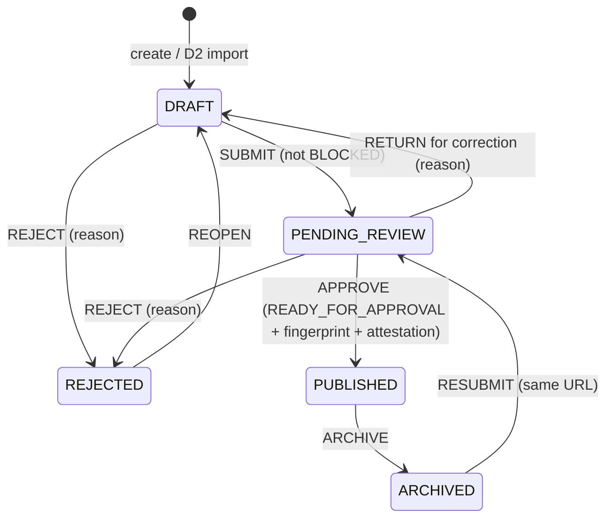

# Data D4 — Product validation, approval and publishing

25 October 2026. Local implementation on branch `codex/data-d2` (uncommitted). No remote/Neon migration, persistent-database migration, deployment, push, paid resource, real product data or D5 work.

## 1. Existing D1–D3 assessment

Inspected the Prisma schema and all 16 prior migrations, `src/lib/product-data`, `src/lib/data-import`, `src/lib/enrichment`, public catalogue/detail/comparison/review/Finder services, admin routes and the D1/D2/D3/remediation reports.

| Area | Found before D4 | D4 decision |
|---|---|---|
| Publication status | `ProductPublicationStatus` already has DRAFT/PENDING_REVIEW/PUBLISHED/ARCHIVED/REJECTED; `canTransitionProduct`; DB trigger keeps legacy `published` in sync and locks slug/identity after first publication | Reused. No new enum. |
| Readiness | D1 `assessProduct` (errors/warnings) and D3 `qualityAssessment` (counts, no score). D3 explicitly reported *no identity attestation* | New deterministic D4 rules engine; identity attestation recorded at approval |
| Concurrency | `version` on entry/claim/image, row locks on variant+entry | Reused; added review fingerprint for stale-evidence protection |
| Audit | `ModerationAction` (mutable table, free-text) | Still written for every action; plus an append-only decision log |
| Evidence/conflicts | Immutable `ProductClaim` observations, CONFLICTED state, contextual weight comparison (`compareClaims`) | Reused for conflict groups and resolution |
| Duplicates | D2 import-time matching, scoped SKU unique index, case-only SKU warning | Reused normalization; added entry-level candidate detection and decisions |
| Images | `ProductImage` licence/verification + `publicAssets()` eligibility | Reused; derived rights states |
| Publishing | `PATCH /api/admin/products/[id]` with D1 quality check only | Routed through the D4 service; old `changePublication` removed |
| Revision history | None | `ProductRevision` snapshots |
| Gap found | Public projection hid a *verified* published value whenever any *incoming* observation was CONFLICTED | Fixed (section 10) |

The persistent local development database still holds 8 sample entries, 1 user, 0 reviews and 14 applied migrations; D2, D3 and D4 migrations remain pending there (read-only `prisma migrate status`). An older disposable QA database from 24 October (`bootverse_browser_384793fd6d35`, not created by this session) still exists; it was left untouched.

## 2. Product lifecycle

Every edge is identical to D1's table and lives in `lifecycleTarget()` (`src/lib/product-review/rules.ts`). Any other transition returns 409. Additional documented rules:

- **Published products are never moved back to review or unpublished because new data arrives.** Updates follow section 10 instead.
- **DRAFT → REJECTED** is kept from D1 for clearly invalid drafts (including duplicate rejection).
- **Republishing** goes ARCHIVED → PENDING_REVIEW → PUBLISHED with full revalidation; slug and variant/colorway identity stay locked by the D1 trigger.
- All transitions need a reason (10–2000 characters). Only active, email-verified ADMINs (role re-read and row-locked in the transaction) may perform any of them.

## 3. Validation architecture

`evaluateProduct(facts)` is pure and deterministic (no DB, network or clock other than the `now` passed in). `loadFacts()` gathers facts for up to 25 products in a fixed number of bounded queries (no per-row queries). Each issue has a code, a dimension, a severity and a human-readable message.

| Dimension | BLOCKING_ERROR | WARNING | INFORMATION |
|---|---|---|---|
| Identity | missing brand/family/generation/tier/colorway/variant; archived brand; Unknown tier; unknown, invalid or inconsistent outsole (manufacturer wording mapped via D2 aliases); verified outsole claim contradicting the variant | no SKU; malformed swatch; SKU citing a revoked source; unverified outsole-mismatch claim | unmapped manufacturer outsole wording |
| Data validity | malformed **verified** claim (unsupported attribute/unit/shape); future observation | malformed unverified claim | count of optional specs without a verified value |
| Source traceability | no primary source; archived/denied source; manufacturer source of another brand; verified claim citing revoked source | undocumented source permission; identity supported only by the source registry (no record URL or SKU) | source usage restrictions; unverified observation count; verified retailer/feed/community values are labeled source-reported |
| Conflicts | CONFLICTED observation; two verified values that contradict | unverified observations that disagree | weights with different size/system/method (not a contradiction) |
| Duplicates | same full identity or case-only-SKU candidate without a covering CONFIRM_NEW decision; INVESTIGATE flag | staged D2 proposals for this product; SKU case collision with a *distinct* product | different tier/outsole/generation (separate products); rejected same-identity record |
| Images | verified image whose permission/source authorization is no longer valid; image file uploaded for another product | no authorized image (placeholder shown); primary image not public; verified but inaccessible file; restricted licence | denied images |
| Page integrity | malformed slug; truncated inspection (record limits) | sample record | — |

Missing optional specifications never block. **Readiness** is derived only from these rules: `BLOCKED` (blocking issue in identity, source or page integrity) · `NEEDS_CORRECTION` (blocking only in data, conflicts, duplicates or images) · `READY_FOR_APPROVAL` (no blockers, status PENDING_REVIEW) · `READY_FOR_REVIEW` (no blockers, other status; shown as "Checks pass" for published/archived). No completeness, confidence or accuracy percentage is produced.

Policy changes versus D1: unknown outsole moved from warning to blocking (FG/AG are separate products); duplicate candidates and invalid verified images now block; approval requires explicit identity/evidence attestation.

## 4. Approval queue and review interface

- `/admin/products/review` — live database counts (draft, pending, published, rejected, archived, unresolved conflicts, possible duplicate identities, missing authorized image, staged import matches) that act as filters; search across brand, family, generation, tier, colorway, SKU and slug; filters for status, source and data quality (conflicts, no authorized image, no SKU, unknown outsole, staged proposals); sort by submission/creation/update; 25 per page; bulk bar. Tables become labeled cards below 768 px.
- `/admin/products/review/[id]` — identity, exact variant and community-review count, primary source with permission/check state, validation report grouped by severity, specifications (published revision vs current verified vs pending proposals), side-by-side conflicts, duplicates and staged proposals, images with rights state, public preview, actions, private notes, decision history and revisions. Evidence and image editing reuse the existing D3 editor (`/admin/products/enrich`) rather than a duplicate editor.
- Every decision uses a native modal `<dialog>` (focus trap, Escape cancels, focus returns to the opener), a required reason, and for approval an identity/evidence attestation checkbox. Loading, empty, error/retry and success states are present. State is never conveyed by colour alone.

API (all ADMIN-only, `private, no-store`; mutations use the existing same-origin/body-size/rate-limit guard):

| Route | Purpose |
|---|---|
| GET `/api/admin/product-reviews` | Queue (`q,status,sourceId,quality,sort,page`) |
| GET `/api/admin/product-reviews/summary` | Dashboard counts |
| GET `/api/admin/product-reviews/[id]` | Review detail |
| POST `…/[id]/transitions` | `{action,version,reason,reviewFingerprint,requestId,identityConfirmed,evidenceChecked}` |
| POST `…/[id]/notes` | Private note |
| POST `…/[id]/conflicts` | Conflict resolution |
| POST `…/[id]/duplicates` | Duplicate decision |
| POST `/api/admin/product-reviews/bulk` | PREVIEW / APPROVE / REJECT |
| PATCH `/api/admin/products/[id]` | D1 contract, now executed by the D4 service |

Rate limits: 120 review mutations and 20 bulk calls per admin per 15 minutes.

## 5. Conflict resolution

A conflict group is every observation for one attribute in the product's scope (this colorway plus shared construction) where any is CONFLICTED or two live values contradict (`compareClaims`, which already compares weight size, size system and method before declaring a contradiction). The request carries the version of every observation the admin compared; any change returns 409.

| Action | Effect |
|---|---|
| SELECT | Selected observation → VERIFIED (requires source check, active permitted source, manufacturer URL origin and brand match, valid shape). Contradicting observations → REJECTED with the resolution note; equivalent or different-context ones are untouched; equivalent CONFLICTED ones → PENDING_REVIEW. |
| UNRESOLVED | Observation → CONFLICTED. |
| REJECT_OBSERVATION | Observation → REJECTED. |
| CORRECTION | Adds a new immutable, attributed observation (source, URL, time, basis, scope, `Administrator correction: …` note) and selects it. |

Nothing is deleted or edited. The decision stores administrator, previous verified values, selected value and its source/type/basis, all compared observations, every state change, reason and time. The newest observation is never preferred automatically, and a retailer value stays labeled as source-reported publicly.

## 6. Duplicate resolution rules

Candidates come from one bounded SQL query: same brand, normalized family and colorway (trim, NFC, collapsed whitespace, case-fold — D2's `identityName`), or a case-only SKU match in the same brand and region. Exact SKU duplicates are refused at write time by D1's scoped unique index (409).

| Relation | Treatment |
|---|---|
| SAME_IDENTITY | Blocking until decided |
| CASE_ONLY_SKU (same generation/tier/outsole, other colorway/family) | Blocking until decided |
| DIFFERENT_TIER / DIFFERENT_OUTSOLE / DIFFERENT_GENERATION | Separate product, information only; warning if their SKUs differ only by case |

Outcomes: **CONFIRM_NEW** (records the current candidate IDs; a later new candidate needs a new decision) · **LINK_EXISTING** (only to a non-rejected SAME_IDENTITY candidate; only for never-published DRAFT/PENDING records; the draft becomes REJECTED and its D2 source-record mappings point to the existing product so future imports update it; claims, images, SKUs and reviews are not moved) · **REJECT_DUPLICATE** (never-published records only) · **INVESTIGATE** (keeps approval blocked). Staged D2 import rows can be acknowledged by a decision; the rows themselves are retained. No merge of products, variants or reviews is ever performed.

## 7. Source verification workflow

The review page shows each value's registered source name, type, original URL (rendered as a link only for `https://`), claimed attribute, observation time, verification status and the primary source's permission state, last-check time and usage restrictions. Rules enforced: an archived/denied source blocks; undocumented permission warns; a reachable or present URL never marks anything verified; verification and selection require an explicit "checked against source" confirmation; critical identity is attested by the approving admin and stored in the APPROVE decision; feed/retailer data keeps its attribution. Public pages label values as source-reported (or measured by the source) and never as independently tested.

## 8. Image rights approval

Derived from existing D3 metadata (no schema change):

| State | Condition | Public |
|---|---|---|
| PERMISSION_CONFIRMED | VERIFIED, licence GRANTED with notes and reference, source GRANTED/NOT_REQUIRED, asset ready | Yes |
| LICENSE_RESTRICTED | as above, source has usage restrictions | Yes, with a review warning |
| PERMISSION_PENDING | anything not yet confirmed | No |
| PERMISSION_DENIED | licence or source permission denied | No |

A product without an authorized image is publishable; the page uses the existing neutral placeholder. No manufacturer image is substituted and no URL is fetched or copied. In the admin preview, external images are displayed only once permission is confirmed; uploaded files use the existing private image API.

## 9. Publishing transaction behaviour

Within one transaction: re-check active ADMIN (row lock) → lock variant and entry rows → replay check by request key → reload facts and re-evaluate → compare entry version and review fingerprint (a hash of every claim/image/SKU/source/duplicate input the reviewer saw) → validate the transition → require READY_FOR_APPROVAL and attestation → update status/version → insert decision → audit → write a revision snapshot. Any failure rolls back status, decision and revision together (tested with an injected constraint failure).

Idempotency: the client generates a request ID per intent; the server stores `sha256(actor, scope, product, requestId)` under a unique index. The same request returns `replayed: true`; the same ID with a different payload returns 409. Two concurrent approvals serialize on the row lock — one succeeds, the other gets 409. Approving an already-published product returns 409. Errors are 400 (blocked/invalid), 401/403 (auth), 404, 409 (stale/conflict/duplicate); unexpected failures return the existing safe 503 with a correlation ID.

After commit, the route calls `revalidatePath` for `/`, `/boots`, `/compare`, `/boot-fit-finder` and `/boots/[slug]`. These pages are already dynamic (`connection()`), so the public catalogue shows a newly published product immediately without editing any static source array.

## 10. Post-publication update policy

- The public projection now uses only VERIFIED evidence. A pending or CONFLICTED incoming observation no longer hides a verified published value (previously it did). The published value changes only when an administrator explicitly verifies, selects, rejects or reclassifies evidence.
- The review page shows Published (last revision) vs Current verified vs Proposed values per attribute.
- Every committed change to what a published page shows — approval, conflict resolution, D1 claim/image verification decisions, D3 image presentation or rights updates — appends a `ProductRevision` snapshot (identity, SKUs, public attributes, public image IDs). Snapshots are de-duplicated by hash, except approvals which always record one.
- New disagreeing data never unpublishes a product. URLs and review associations are unaffected.
- **Limitation:** this is a minimal, backward-compatible revision model. It records what was public; it does not stage a full alternate copy of a product for one-click rollback. Image rights revocation intentionally takes effect immediately (it removes permission) and is recorded as a revision.

## 11. Audit logging

- `ProductReviewDecision`: append-only. A trigger refuses UPDATE and DELETE; only foreign-key `SET NULL` fired by a parent deletion is allowed (checked with `pg_trigger_depth()`). `entryKey` keeps the product ID even if that link is nulled. Check constraints bound reason/details size, require a fingerprint on APPROVE and pair request key/hash.
- `ProductRevision`: same guard; only a cascade from deleting its product removes rows.
- `ModerationAction` continues to receive PRODUCT_STATUS, PRODUCT_NOTE, RESOLVE_CONFLICT and RESOLVE_DUPLICATE entries for continuity with the existing moderation history.
- Notes and decisions are only returned by ADMIN endpoints; tests confirm they never appear on public pages or APIs.

## 12. Database changes and migration safety

Migration `20261025010000_product_approval` (single transaction, additive): nullable `CatalogueEntry.submittedAt` + index; `ProductReviewDecision`; `ProductRevision`; FKs, unique request key and revision number, indexes, check constraints and the append-only trigger function. No existing row is changed, published, merged or deleted.

Verification: applied to a disposable database on its own and inside the isolated suite; the legacy→D1→D2→D3→D4 rehearsal confirms identical product state/version/slug lock and claim state before and after, no products marked submitted, and enforced append-only/check constraints. `scripts/verify-database.mts` and `/api/health/ready` now require the D4 migration, constraints and triggers. **Not applied** to the persistent local database or any Neon/remote database. Deployment needs the same approval/backup/rehearsal procedure as D1–D3; rollback is "keep the additive schema and redeploy the previous application".

## 13. Security controls

| Threat | Control |
|---|---|
| Broken access control / privilege escalation | Server-side ADMIN check per request and again with a row-locked role read inside every transaction; UI gates are cosmetic only; moderators and members get 403 |
| CSRF | Existing same-origin check on every mutation (cross-origin → 403) |
| IDOR | IDs validated; duplicate links only to same-identity candidates; conflict claim must belong to the product/attribute; staged rows must belong to the product; request keys scoped to actor and product |
| Injection | Zod `.strict()` bodies; Prisma queries and tagged `$queryRaw` parameters only (the one `Prisma.raw` is a fixed column expression) |
| XSS / malicious URLs | React escaping; links rendered only for `https://`; `rel="noopener noreferrer"`; no HTML injection (tested) |
| Unsafe images | No fetching or proxying; external previews only after permission is confirmed; `referrerPolicy="no-referrer"` |
| Races / repeated requests | Row locks, version + fingerprint checks, unique request keys, per-item bulk transactions |
| Audit tampering | Append-only triggers on decision/revision tables |
| Sensitive metadata | Admin responses `private, no-store`; public projections never read review tables |
| Abuse | Body-size limit and per-admin rate limits; bulk max 25 items |

`npm audit`: 0 vulnerabilities. No new dependency. A scan of configured local credentials found none in source, tests, scripts, docs or the diff (only previously present non-secret values such as the local app URL and sender address).

## 14. Test results

| Check | Command | Result |
|---|---|---|
| Prisma schema | `npx --no-install prisma validate` | PASS |
| TypeScript | `npm run typecheck` | PASS |
| ESLint | `npm run lint` | PASS |
| Unit/component | `npm test` | PASS — 339 tests, 37 files (311 before D4) |
| Production build | `npm run build` | PASS |
| Isolated integration + migration rehearsal + benchmarks | `BOOTVERSE_BENCHMARK=1 npm run test:platform:local` | PASS — 132/132, 0 failed/skipped, 29.2 s (117 before D4) |
| Browser (Playwright CLI, disposable QA server) | `npm run test:browser -- <suite>` | PASS — catalogue, admin, profile, enrichment, imports, data, review on a fresh QA database; review, catalogue and data re-run PASS on the final build |
| Dependency audit | `npm audit` | PASS — 0 |
| Persistent DB migration status | `prisma migrate status` (read-only) | PARTIAL — D2, D3, D4 pending by design; data unchanged |
| Mutation sensitivity | invert guards in rules/projection, run tests, restore | PASS — 6 mutations caught; one survivor found and fixed with a new test |

D4 integration coverage (`tests/product-review.integration.ts`, 14 tests over real HTTP/PostgreSQL): anonymous 401, member/moderator 403 (single and bulk), cross-origin 403, forged fields 400; unknown tier and unknown/inconsistent outsole blocked; optional specs not blocking; exact duplicate SKU refused, case-only SKU warning between FG and AG; Elite/Pro, FG/AG and generation separation; refused cross-tier link, same-identity link without destructive merge; submit → stale fingerprint 409 → attestation required → approve → replay → reused-ID 409 → duplicate approval 409; return/reject/reopen and invalid transitions; drafts hidden from detail URL, search, compare and ratings; conflict resolution keeps rejected evidence, preserves the published value during a conflict and records revisions; weight context; image rights confirmed/revoked/pending with placeholder; concurrent approvals (one 200, one 409); blocked publication; rollback; bulk mixed outcomes, limit, confirmation, permission and replay; archive with review row retained, locked slug, republish with the same URL/variant; private notes absent publicly; audit tampering refused; dashboard counts equal SQL counts; search by brand/SKU and quality/source filters; 60 same-identity drafts: every product on a queue page reports its duplicates.

Browser `review` suite: queue filter, bulk preview showing a blocked record with approval disabled, blocked detail with disabled submit, submit and attested approval through dialogs, public page visible, revision listed, keyboard open/Escape/focus return, archive returning the page to 404, no horizontal overflow at 320/768/1024/1440 px. Screenshots (git-ignored): `output/playwright/d4-review-{queue,detail}-{desktop,mobile}.png`; layout visually inspected.

**Scale defect found and fixed.** The first run with `BOOTVERSE_BENCHMARK=1` failed: after the D2 benchmark imports 5,000 drafts sharing one full identity, the dashboard returned 503. Measured on a disposable 6,000-row database (3 runs each):

| Change | Before → after | Verdict |
|---|---|---|
| Dashboard duplicate count: self-join → `GROUP BY … HAVING count(*)>1` | 13.4 s → 30 ms, same result (6,000) | kept |
| Candidate query: global `LIMIT` → per-entry `row_number()` cap of 50 | 70–87 ms → 163–172 ms; entries on a 25-row page with candidates **1 → 25** | kept (correctness: the old query hid duplicates for 24 of 25 products) |

Other dashboard queries at 6,000 distinct rows: conflicts 45 ms, missing images 3 ms. Recommendation benchmarks in the same run: p95 10.0 ms (7 variants) and 82.0 ms (100 variants / 2,000 reviews), error rate 0.

Failures during development (fixed, not hidden): first integration run had 4 failures — a SQL parameter type in the new migration test; the D3 assertion that expected the old "conflict hides verified value" behaviour (updated to the D4 policy); bulk approval marking a *distinct* sibling stale (fingerprint scope corrected, with a unit test); and a synthetic review body below the 40-character constraint. In the browser, the first `review` rerun failed because the previous run had published its fixture, and `catalogue`/`enrichment` failed on a shared QA database because of ordering side effects; the D4 test now archives its fixture, and all suites passed on a fresh QA database. One sign-in scripting attempt failed and its unauthenticated results were discarded.

Not tested: Neon/remote databases, production email/storage/IAM, load beyond the existing benchmark, screen-reader or axe certification, cross-browser devices. Cache invalidation is verified by behaviour (immediate public visibility), not by inspecting Next's cache.

## 15. Known limitations

- Duplicate detection computes normalized names over all catalogue entries on each queue page (≈170 ms worst case measured at 6,000 rows); a stored, indexed normalized-identity key would be needed for much larger catalogues. A product with more than 50 same-identity candidates is reported as an incomplete inspection (blocked) rather than reviewed from a truncated list.
- Queue filtering by computed readiness is not available in SQL; quality filters use SQL-expressible signals and readiness is shown per row.
- D2 staged rows with no linked product (ambiguous name matches) are counted on the dashboard but resolved through import tooling, not the product review page.
- LINK_EXISTING leaves the rejected draft's SKUs on that draft; the scoped unique index therefore still reserves them.
- Revisions record public snapshots; they are not a full draft/version editor.
- The D1 trusted-writer bridge (direct `published` writes by seed scripts/SQL) still exists for compatibility; application code no longer uses it.
- Bulk attestation applies one checkbox to the whole batch; per-item identity review still happens via the preview list.
- No sitemap exists in the app, so there was nothing to update.

## 16. D4 acceptance checklist

| Requirement | Status |
|---|---|
| D1–D3 audited and reused (no parallel status/evidence/storage system) | PASS |
| Server-validated lifecycle, documented transitions | PASS |
| Deterministic validation engine with severities, no fabricated scores | PASS |
| Readiness assessment with human-readable reasons | PASS |
| Approval queue with real counts, search, filters, sort, pagination | PASS |
| Detailed review UI with all required sections and actions | PASS |
| Conflict resolution preserving evidence and recording decisions | PASS |
| Duplicate detection/resolution without destructive merges | PASS |
| Source verification and image rights rules | PASS |
| Transactional, idempotent, concurrency-safe publishing with audit | PASS |
| Post-publication change policy and revision history | PASS (minimal model, see limitations) |
| Rejection/correction workflow, private notes | PASS |
| Controlled bulk review | PASS |
| Public visibility (catalogue, detail, search, compare, reviews, Finder) | PASS — existing `published=true` gates confirmed; Finder covered by its regression suite |
| Security controls and tests | PASS |
| Migration safety (local rehearsal only) | PASS; remote/persistent activation NOT PERFORMED |
| Report | This document |

## 17. Readiness for D5

D4 provides what scheduled updates need: incoming observations stay unverified and cannot change public data; conflicts surface in the queue; every public change is revisioned and audited; publication requires a human. D5 should feed its observations through the existing D2/D3 services, rely on fingerprints to invalidate stale reviews, and must not call the publishing service. **Ready for D5 implementation against isolated local databases; not ready for production activation** until the D2–D4 migrations are approved, rehearsed and applied to a target database.

Skills loaded and followed: incremental-implementation, security-and-hardening, api-and-interface-design, test-driven-development, frontend-ui-engineering, ui-ux-pro-max (UX guideline search for tables, confirmation and bulk actions; existing BootVerse tokens kept), playwright, code-review-and-quality, performance-optimization. The memory note asks for a "Ponytail" skill; it is not installed in this environment, so it was not used. No subagents were used.

### Changed files

New: `prisma/migrations/20261025010000_product_approval/`, `src/lib/product-review/{rules,contracts,facts,service,revalidate}.ts` (+ `rules.test.ts`, `projection.test.ts`), `src/components/product-review/{shared,queue,detail,evidence}.tsx` (+ `panels.test.tsx`), `src/app/admin/products/review/**`, `src/app/api/admin/product-reviews/**`, `tests/product-review.integration.ts`, this report.

Modified: `prisma/schema.prisma`; `src/lib/product-data/{service,projection}.ts` (exported shared helpers, removed `changePublication`, revision hook, projection policy); `src/lib/enrichment/{service,public}.ts` (revision hooks, projection policy); `src/app/api/admin/products/[id]/route.ts`; `src/app/api/health/ready/route.ts`; `src/app/admin/page.tsx`; `src/app/globals.css`; `scripts/{verify-database.mts,browser-qa.mjs,browser-regressions.mts}`; `tests/{auth,product-data,product-enrichment,product-migration}.integration.ts`; `tests/browser-regressions.mjs`.
