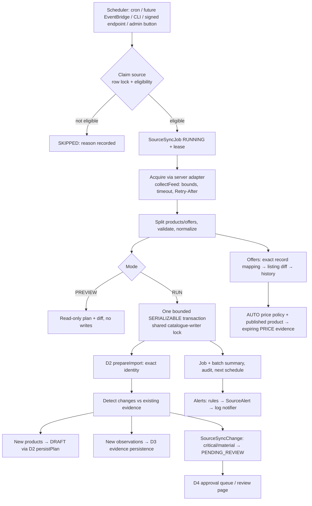
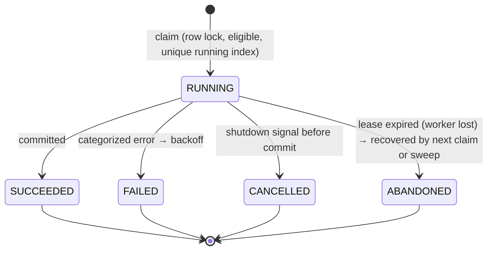

# Data D5 — Scheduled synchronization, change detection and source monitoring

27 October 2026. Local implementation on branch `codex/data-d2`. **No live authorized source exists, so no real source was synchronized.** Everything was exercised with synthetic fixture feeds against disposable local databases. No Neon/remote migration, AWS resource, scheduled-job deployment, scraping or push.

## Audit of D1–D4 before D5

| Area | Found | D5 decision |
|---|---|---|
| Source registry (D1) | Type, authorization status, permission notes/URL, check time; no scheduling | Extended with scheduling/health columns; credentials still never stored |
| Feed adapters (D2) | `FeedAdapter` + `collectFeed`: auth gate, bounded pages/rows/bytes, timeouts, 3 retries with Retry-After; every failure collapsed into one error | Reused; added categorized `FeedFailure` (same messages) so backoff can tell rate limits from revoked credentials |
| Identity resolution (D2) | `readGraph` + `prepareImport` + `persistPlan`; exact SKU/record matching, no name merges | Reused unchanged as the only identity resolver |
| Evidence (D3) | `prepareEnrichment` + persistence with fingerprinted immutable observations | Reused; **gap:** its fingerprint includes the timestamp, so re-syncing an unchanged value would add a claim every run → D5 filters same-source equivalent values first |
| Gap in D2 | A SKU change on an already-mapped record was silently ignored | D5 reports it as a critical `SKU_CHANGE` |
| Approval (D4) | Queue, readiness rules, fingerprints, append-only decision log | Reused as the only approval system |
| Prices/stock | `RecommendationEvidence` PRICE (approved flag, expiry, country) feeds public pages and the Finder; AVAILABILITY is a size-scoped boolean | PRICE kept as the single public projection; new listing-state tables for current/previous price and 5-state stock |
| Jobs/scheduling | None in-app; Phase 4.1 plans maintenance jobs run "once/hour with single-worker lock" from a separate image | Same pattern: CLI entrypoint + DB locks |
| Observability | `serviceFailure` structured errors with correlation IDs | Structured sync events with job ID and entry point |

Existing persistent dev database: 8 entries / 1 user / 0 reviews, 14 applied migrations; D2–D5 migrations pending there (read-only `prisma migrate status`).

## 1. Architecture

Fetching (`adapters.ts`, `collectFeed`) is separate from pure comparison (`detect.ts`, `offers.ts`, `policy.ts`, `alert-rules.ts`) and from persistence (`runner.ts`). Code: `src/lib/source-sync/`.

## 2. Source scheduling rules

New `ProductSource` columns: `syncEnabled` (default false), `adapterKey`, `syncIntervalMinutes`, `minIntervalMinutes` (provider minimum, default 60), `fieldPolicy`, `lastSyncAttemptAt`, `lastSyncSuccessAt`, `nextSyncAt`, `syncFailureCount`, `backoffUntil`, `lastSyncErrorCategory`. A DB check requires an adapter and interval before sync can be enabled, and interval ≥ provider minimum.

`eligibility()` (in order): ACTIVE source → GRANTED/NOT_REQUIRED **with** permission notes, reference and check time → authorization checked within `SYNC_AUTHORIZATION_REVIEW_DAYS` (180) → adapter registered on this server → (scheduled only) sync enabled → not in backoff → provider minimum interval elapsed (manual runs too) → (scheduled only) `nextSyncAt` reached. Manual runs ignore the schedule toggle but nothing else.

The suggested intervals (catalogue daily/weekly, specs weekly/monthly, prices intra-day only if permitted) are operator choices bounded by `minIntervalMinutes`; nothing assumes a source permits automated access.

## 3. Authorization and access controls

- Sync never runs for undocumented sources, even if forced on in the database (tested). Permission is changed only in the D1 registry; the D5 settings form cannot grant it.
- Credentials live only in server environment variables (`SYNC_FEED_<NAME>_TOKEN`), are injected per request, redacted from any message, and never stored or sent to browsers. Sources store only an adapter key.
- All admin routes: ADMIN role re-checked inside the transaction, same-origin check, rate limits (manual trigger 10 / 15 min per admin, config 30, alerts 60).
- Sync writes refuse non-local databases (reuses D2's `localImportsOnly`). Activating elsewhere is a deliberate, reviewed change.

## 4. Source adapters

| Adapter | Status |
|---|---|
| `fixture:<name>` | Local synthetic JSON (`SYNC_FIXTURE_DIR`, default `fixtures/sync`). Only when `SYNC_FIXTURES_ENABLED=1`. Path confined with `realpath`; supports simulated 401/429/503. Fully tested. |
| `http:<name>` | Operator-configured HTTPS JSON feed (`SYNC_HTTP_FEEDS`, `SYNC_FEED_<NAME>_URL/_TOKEN/_MODE`, host in `SYNC_ALLOWED_HOSTS`). Unit-tested pieces; **never run against a real provider (NOT TESTED live)**. |
| Manual snapshots / CSV / JSON uploads | Existing D2 import and D3 enrichment screens (unchanged). |

Feed format: D2 version-1 product records with `kind: "product"` (no inline offers) plus listing records with `kind: "offer"` (`recordId`, optional `listingId`, `countryCode`, `currency`, `price`, `availability`, optional size pair, `sourceUrl`, `observedAt`, `status` ACTIVE/DELISTED). Adapter `mode` SNAPSHOT = complete feed, DELTA = partial.

**To activate a real feed:** (1) obtain written permission and record it in the source registry (GRANTED, notes, reference URL); (2) set `SYNC_HTTP_FEEDS`, the feed URL, allowed host and token in the server's secret store; (3) choose the adapter, interval ≥ the provider's contractual minimum, and price/stock policy on `/admin/data-sources/<id>`; (4) run **Preview changes** and review; (5) run once manually; (6) enable the schedule. A remote database additionally needs the approved migration procedure and removal of the local-only guard in a reviewed change.

## 5. Change detection algorithm

1. D2 `prepareImport` resolves identity (record mapping or exact brand/region/SKU with full identity; never names). Outcomes map to `NEW_PRODUCT`, `EXISTING_PRODUCT`, `POSSIBLE_DUPLICATE`, `IDENTITY_CONFLICT`, `INSUFFICIENT_INFORMATION` (or INVALID). A D2 conflict that is only a specification disagreement is still an exact product.
2. New products record which identity levels are new (brand, family, generation, tier, outsole variant, colorway, SKU).
3. For exact products, each incoming specification is normalized (D3 rules: whitespace, case, NFC, units, outsole aliases) and compared:
   - same value already reported by this source (any status, even rejected) → no change;
   - equivalent to verified evidence from another source → corroboration;
   - contradicts evidence → contradiction (outsole/playing-surface attributes → critical);
   - new attribute or new measurement context (weights of other sizes/methods) → new value.
4. Images: new external references → added; references from this source absent from a **complete** snapshot → removal notice (public or not). Nothing is downloaded or deleted.
5. SKU not among the product's identifiers → critical SKU change (never applied). Changed source URL → routine metadata.
6. Every change has a stable SHA-256 key (source, record, product, kind, attribute, proposed value); re-detection only updates `lastSeen`.

## 6. Material-change classification

| Severity | Kinds (default) | Handling |
|---|---|---|
| CRITICAL | IDENTITY_CONFLICT, OUTSOLE_CHANGE, SKU_CHANGE, SAFETY_SPEC_CHANGE | Pending review; blocks D4 approval/resubmission of that product |
| MATERIAL | NEW_PRODUCT, POSSIBLE_DUPLICATE, SPEC_CONTRADICTION, SPEC_NEW_VALUE, IMAGE_ADDED, IMAGE_REMOVED (public) | Pending review; D4 warning |
| ROUTINE | SPEC_CORROBORATION, IMAGE_REMOVED_NONPUBLIC, SOURCE_METADATA, INSUFFICIENT_INFORMATION, price/stock updates | Recorded |

`SYNC_SEVERITY_OVERRIDES` (JSON) can raise severities but can never lower them (tested). Verified claims are never overwritten: new values enter as UNVERIFIED (or CONFLICTED) observations. Routine retail updates are automated only when the source is authorized, its field policy says AUTO, validation passes, the listing maps to an exact product through the source's own record mapping, and provenance/time are stored.

## 7. Price and availability policy

- `ProductOffer` holds one listing (source, listing key, exact entry+variant, **required** country, optional size pair): current and previous price/currency, 5-state availability with the raw provider label, first/last observed, last changed, `missingSince`, `priceMissingSince`, ACTIVE/REMOVED. `ProductOfferObservation` is the append-only history, written only on change, initial sighting, removal, missing price or an evidence refresh; unique (listing, observedAt).
- Prices are integer minor units. Accepted: `199.95`, `1,299.00`, leading `$€£¥₫`, trailing ISO code equal to the declared currency. Rejected: negatives, zero, >2 decimals, `1.299,00`, mismatched currency, > 9,999,999.99.
- Different currency → `CURRENCY_CHANGE`, no delta computed. Different country or size → different listing; nothing is inferred across them. Unmapped records are refused.
- Missing price keeps the last price and records the gap once. Absent stock signal keeps the last state; unrecognized labels become UNKNOWN. Absence from a DELTA feed changes nothing; from a SNAPSHOT it sets `missingSince` only. Only explicit `DELISTED` removes a listing. Out-of-order observations are ignored.
- Field policy per source: prices/stock `RECORD` (private monitoring, default), `AUTO`, or `OFF`. Under AUTO, a **published** product gets a country-scoped, approved PRICE evidence row expiring after `SYNC_PRICE_EVIDENCE_HOURS` (48 h; refreshed after 24 h while unchanged). Public pages already show only fresh, approved PRICE evidence; the Finder excludes country-scoped offers, so no regional price leaks into it. Availability is monitored only (not public). Catalogue publication is independent of stock. Consumer price alerts are not built.

## 8. Stale data

Configurable (`SYNC_PRICE_FRESH_HOURS` 24, `SYNC_STOCK_FRESH_HOURS` 12, `SYNC_PRICE_EVIDENCE_HOURS` 48, `SYNC_AUTHORIZATION_REVIEW_DAYS` 180, `SYNC_STALE_FEED_MULTIPLIER` 3; D3 technical windows unchanged). Old observations are marked STALE in the admin offers table and never deleted. Expired price evidence disappears from public pages (tested). Identity never changes from staleness. A source with no success for 3× its interval raises STALE_FEED.

## 9. Scheduler execution model

| Entry point | Command / route | Use |
|---|---|---|
| CLI (primary) | `npm run sync:due`, `npm run sync:sweep`, `npm run sync:run -- <sourceId> [--preview]` | Cron or a container task (future EventBridge → one-off task); same pattern as `storage:cleanup` |
| Signed endpoint | `POST /api/internal/source-sync` `{action:"due"|"sweep"}` | Optional cloud hook; 404 unless `SYNC_SCHEDULER_SECRET` (≥32 chars) is set |
| Admin | `/admin/data-sources/<id>` buttons | Manual preview/run |

No timer runs inside Next.js request handlers. Multiple instances may call `sync:due` at once safely. Nothing depends on a developer machine staying on, and no cloud schedule was activated.

## 10. Locking and idempotency

- **Per-source lock:** partial unique index `SourceSyncJob(sourceId) WHERE status='RUNNING'`, claimed under a `FOR UPDATE` lock on the source row; a concurrent claim gets `ALREADY_RUNNING`.
- **Leases:** `SYNC_LEASE_MINUTES` (15), heartbeat every third; a lost lease aborts the worker; expired leases become ABANDONED on the next claim or sweep, so no lock stays stuck (tested with a simulated crashed worker).
- **Stable keys:** scheduled runs `sched:<interval>:<window>`, manual `manual:<requestId>` (`RUN_ID` for CLI), unique per source; import batch `sync-<jobId>`.
- **Writer serialization:** the same advisory transaction lock as D2/D3 (one catalogue writer at a time); busy → short retry, not counted as a failure.
- **Bounded transaction:** one SERIALIZABLE transaction per run (180 s cap) with 250-row chunks and bulk `UPDATE … FROM (VALUES …)`; the DB re-checks permission and lease inside it.
- **Idempotent data:** D2 source-record mappings, same-source equivalence filter, change keys (`ON CONFLICT DO UPDATE lastSeen`), offer history unique (listing, time). Re-running unchanged data created 0 products, claims, changes, observations, evidence rows or images (tested, and 0 duplicates at every benchmark size).
- **Cancellation:** SIGINT/SIGTERM stop acquisition and start no new source; an uncommitted run rolls back.

## 11. Retry and recovery

Within a run: `collectFeed` retries 429/5xx up to 3 attempts honouring Retry-After ≤ 30 s. Longer Retry-After ends the run as RATE_LIMITED with that delay. Across runs: exponential backoff from 5 min, ±20 % jitter, capped at 24 h; Retry-After wins if longer; permanent categories (AUTHORIZATION, NOT_PERMITTED, CONFIG) back off for the cap and alert. Categories: AUTHORIZATION, NOT_PERMITTED, CONFIG, TIMEOUT, UNAVAILABLE, RATE_LIMITED, INVALID_FEED, PARTIAL_FEED, DATABASE, STORAGE, BUSY, WORKER_LOST, CANCELLED, INTERNAL. Stored error details are fixed text per category, never provider output. A feed with more than `SYNC_MAX_REJECT_RATE` (50 %) invalid records is refused before writing. If the database itself is down, finalization fails safely and the lease recovers the job later.

Operating procedure: see the "To activate" steps above and `docs/runbooks/source-sync.md`. Local manual test: `SYNC_FIXTURES_ENABLED=1 node --env-file=.local/development.env --conditions=react-server --import tsx scripts/sync-sources.mts run <sourceId> --preview` with a source whose adapter key is `fixture:synthetic-example` (synthetic file provided).

## 12. Admin dashboard

`/admin/data-sources`: health counts (Healthy, Degraded, Failing, Disabled, Never synchronized) derived from source/job/alert rows, pending source-change count linking to the D4 queue, configured live feeds (currently none), per-source authorization, last success/attempt, next check, failures and alerts. `/admin/data-sources/<id>`: status, eligibility reason, **Preview changes** and **Run sync now** (confirmation dialog; disabled with the reason when not eligible), audited settings form (schedule toggle, adapter key, interval, provider minimum, price/stock policy), alerts with acknowledge/resolve, recent jobs, detected changes, paginated offers with stale markers. Linked from `/admin`.

## 13. D4 integration

- No second approval system. New products are D4 DRAFTs; NEW_PRODUCT notices resolve when D4 approves or rejects the product.
- Specification changes are D3 observations; deciding them in D4 (conflict resolution or verification) resolves the linked sync change automatically.
- Non-evidence changes (SKU, identity, image notices) show in a **Source changes** panel on the D4 review page with Acknowledge/Dismiss; each decision is a `SYNC_CHANGE` entry in D4's append-only decision log. Dismissed changes are never raised again.
- D4 readiness: pending critical change → blocking; material → warning; pending changes are part of the review fingerprint, so an approval prepared before a new sync result is refused as stale.
- D4 queue filter and dashboard tile "Pending source changes"; deep link `/admin/products/review?quality=sync_changes`.
- Published values are preserved (D4 policy); disagreeing sources never unpublish.

## 14. Observability and alerts

Structured JSON events: `sync_job_started`, `sync_job_finished`, `sync_job_failed`, `sync_job_skipped`, `sync_sweep_finished`, `source_alert`, each with `requestId` (job ID) and `entryPoint`. Job rows keep counts and timings. Alert rules (pure, tested): REPEATED_FAILURES and AUTHORIZATION_EXPIRED (PAGE); LONG_RUNNING_JOB, EXCESSIVE_CONFLICTS, FEED_SIZE_DROP, STALE_FEED, HIGH_REJECTION_RATE (TICKET). One open alert per condition (partial unique index); repeats increment a counter; success resolves failure/staleness alerts. Every message links to the runbook. The default notifier only writes the log line and records `LOGGED`; no email or third-party channel exists, and nothing claims delivery.

## 15. Database changes

Migration `20261027010000_source_sync` (single transaction, additive, generated DDL verified to have no drops): ProductSource scheduling columns and check; tables `SourceSyncJob`, `SourceSyncChange`, `ProductOffer`, `ProductOfferObservation`, `SourceAlert`, `SchedulerNonce`; enum `OfferAvailability`; partial unique indexes for the running-job lock and open-alert dedupe; check constraints on all new tables; ProductImportBatch purpose gains `SYNC`; D4 decision kinds gain `SYNC_CHANGE` (append-only guard unchanged). Rehearsed on its own and after legacy→D1…D4: every product and source unchanged, sync disabled everywhere. `db:verify` and readiness now require it. Not applied to the persistent dev DB or any remote DB.

Retention: `sync:sweep` clears raw canonical row payloads of sync batches older than `SYNC_PAYLOAD_RETENTION_DAYS` (30) and scheduler nonces older than a day; outcomes, provenance, changes and price history are kept. Unchanged exact products produce no import rows.

## 16. Security assessment

| Threat | Control | Evidence |
|---|---|---|
| Broken access / escalation | ADMIN check per request and inside transactions; UI gates cosmetic | 401/403 tests (anonymous, member, D4 sync-change endpoint) |
| Scheduler endpoint | HMAC-SHA256 over timestamp.nonce.body, ±5 min, single-use nonce (unique), timing-safe compare, 1 KB body, rate limit, disabled without a ≥32-char secret | unit + integration (bad signature 401, replay 409) |
| SSRF | URLs only from server env; HTTPS; host allowlist; no literal IPs, credentials or secret query keys; DNS checked **at socket connect** for every address (rebinding-safe); private/loopback/link-local/metadata/CGNAT/ULA/IPv4-mapped blocked; redirects refused; 10 MB cap; JSON content type | unit tests; live transport NOT TESTED |
| Credentials | Env-only, redacted, never in DB/logs/responses | redaction test; secret scan |
| Path traversal | Adapter key regex + `realpath` containment | integration (traversal keys rejected) |
| SQL injection | Prisma and tagged parameters; VALUES lists via `Prisma.join` | review |
| XSS / malicious feed content | React escaping; links only for `https://`; strict Zod schemas; bounded sizes/rows/depth | component tests (D4) |
| CSRF | same-origin guard | cross-origin 403 test |
| Race / replay | row locks, partial unique index, idempotency keys, change keys | concurrency + idempotency tests |
| Audit integrity | ModerationAction entries for config/sync/alerts; D4 decisions append-only | migration rehearsal |
| Data exposure | admin APIs `private, no-store`; public pages never read sync tables | tests |

Mutation check on the pure modules: 8 of 9 deliberate rule breaks were caught by tests; the survivor (removing the explicit `::1` check) is equivalent because the `::` prefix rule still blocks it. `npm audit`: 0 vulnerabilities (full tree). No new dependency.

## 17. Performance (measured, local, synthetic)

`node --conditions=react-server --import tsx tests/benchmark-sync.mts` — disposable DB, half products (1 spec each) / half offers, one run each of initial, unchanged repeat, and "every price and one spec changed":

| Feed records | Pass | Total ms | Fetch ms | Detect+persist ms | Write txn ms | New drafts | New observations | New change rows | Rejected |
|---:|---|---:|---:|---:|---:|---:|---:|---:|---:|
| 10 | initial / unchanged / changed | 180 / 26 / 30 | 1 / 0 / 0 | 22 / 0 / 8 | 64 / 18 / 22 | 5 / 0 / 0 | 5 / 0 / 5 | 5 / 0 / 5 | 0 |
| 100 | initial / unchanged / changed | 90 / 28 / 65 | 1 / 1 / 1 | 46 / 1 / 31 | 83 / 22 / 59 | 50 / 0 / 0 | 50 / 0 / 50 | 50 / 0 / 50 | 0 |
| 1,000 | initial / unchanged / changed | 599 / 136 / 435 | 9 / 10 / 10 | 352 / 3 / 241 | 575 / 114 / 413 | 500 / 0 / 0 | 500 / 0 / 500 | 500 / 0 / 500 | 0 |
| 5,000 | initial / unchanged / changed | 2,829 / 652 / 2,250 | 49 / 49 / 55 | 1,716 / 14 / 1,241 | 2,737 / 556 / 2,154 | 2,500 / 0 / 0 | 2,500 / 0 / 2,500 | 2,500 / 0 / 2,500 | 0 |

Duplicate rate 0 % and error rate 0 % at every size. Process high-water RSS grew from 307 MB to 725 MB across the whole benchmark process (all sizes in one process; not per-run memory). SQL query counts were not instrumented. Bulk reads/writes avoid per-row queries (offer updates use one statement per 250 rows). The adapter row cap is 5,000 per run; larger feeds need splitting or a queue-based worker — the claim/lease/job model already supports moving execution to a queue without changing detection or persistence.

## 18. Test results

| Check | Command | Result |
|---|---|---|
| Prisma schema | `npx --no-install prisma validate` | PASS |
| TypeScript | `npm run typecheck` | PASS |
| ESLint | `npm run lint` | PASS (0 warnings/errors) |
| Unit/component | `npm test` | PASS — 432 tests, 43 files (339 before D5) |
| Isolated integration (all phases, D5, migrations, benchmarks) | `BOOTVERSE_BENCHMARK=1 npm run test:platform:local` | PASS — 148/148, 0 failed/skipped, 30.0 s (132 before D5; 146 without benchmark flag) |
| Production build | `npm run build` | PASS |
| Docker image (linux/amd64, local only) | `docker build --platform linux/amd64 .` | PASS — 112 MB image; container smoke: live 200, ready 503 without DB credentials (correct), scheduler endpoint 404 without secret; image kept local, container removed |
| Browser (Playwright CLI) | `npm run test:browser -- <suite>` | PASS — sync, catalogue, admin, profile, enrichment, imports, data, review on a fresh QA database (final build); 320/768/1024/1440 px and keyboard checks in sync/review |
| D5 benchmark | `tests/benchmark-sync.mts` | PASS (table above) |
| Persistent DB migration status | `prisma migrate status` (read-only) | PARTIAL: D2–D5 pending by design; data unchanged |
| Live authorized source | — | NOT TESTED: none configured |
| HTTP adapter against a real provider | — | NOT TESTED |
| Cloud scheduler, real notifications, Neon | — | NOT TESTED / not authorized |

D5 integration cases (`tests/source-sync.integration.ts`, 14 tests): setup; access control (anonymous/member/CSRF/unsafe and traversal adapter keys/unregistered adapter/undocumented source even when forced on); signed endpoint (missing/bad signature, replay, due run, not due again); new products as drafts with review items and unmapped offers refused; D4 publication and resolution of new-product notices; detection of new tier/outsole product, possible duplicate, critical SKU change, new value, new image, whitespace-only no-op, D4 queue and blocking issue; contradiction kept private and resolved via D4; price increase/decrease, currency-safe new country listing, stock change, public evidence only for the published product; idempotent repeat; dismiss audited and never re-raised; delta vs snapshot absence, explicit delisting, missing price/stock, stale marking, expired evidence hidden; concurrency (one SUCCEEDED, one SKIPPED) and crashed-lease recovery; rate limit with Retry-After and manual backoff block, 503, malformed feed, repeated-failure alert with honest delivery, 401 authorization alert and acknowledgement, mostly-invalid feed refused, injected database failure with full rollback; preview and CLI write nothing; health derived from records.

Failures during development, fixed and not hidden: a currency-blind "refresh" of a price the feed no longer reported (caught by a unit test); a phantom evidence refresh for draft products (smoke run); the invalid-feed guard ignoring D2 row rejects (found in review before the test ran); test-side mistakes (a wrong helper argument, a fixture that was already correctly marked missing, inconsistent timestamps rejected by a DB check, a benchmark SQL type). Visual review found admin table cells breaking words mid-word in narrow columns; table wrapping was changed to break between words and re-verified. PostgreSQL needed `LC_ALL` to start after a restart; Docker Desktop had to be started for local storage.

## 19. Known limitations

- No authorized live source exists, so live synchronization is disabled and has never run against a provider.
- Sync refuses non-local databases until a reviewed activation change.
- One run handles at most 5,000 feed records; no queue worker yet.
- Availability is monitored privately; public pages show prices only.
- Feeds may not reference private uploads; image references stay metadata until rights are reviewed (no download).
- New drafts are not auto-submitted; a reviewer submits them in D4.
- A dismissed change for a value is permanent for that source/product/value.
- Default notifier logs only; no email/Slack/webhook integration.
- The DNS check stops private addresses but not a malicious public host on the allowlist; allowlisting is an operator responsibility.
- Benchmarks are local, single-process and synthetic; production latency/throughput not measured.

## 20. D5 acceptance checklist

| Requirement | Status |
|---|---|
| D1–D4 audited; D2/D3/D4 reused, no parallel ingestion or approval | PASS |
| Scheduling config, due/disabled/unauthorized/backoff/rate-limit rules | PASS |
| Authorized adapters, no scraping, credentials server-side | PASS (fixture tested; HTTP live NOT TESTED) |
| New product detection with five outcomes, drafts only, no merges | PASS |
| Deterministic change detection without formatting false positives | PASS |
| Critical/material/routine policy, configurable upward only | PASS |
| Price monitoring (currency/country/size-safe, history, freshness, removal rules) | PASS |
| Availability monitoring (5 states, no inference) | PASS |
| Stale data rules | PASS |
| Environment-independent scheduler, no in-request timers | PASS |
| Locks, leases, idempotency, bounded transactions, cancellation | PASS |
| Failure handling, backoff with jitter, Retry-After, permanent failures | PASS |
| Sync history and retention | PASS |
| Admin dashboard with real health | PASS |
| D4 integration with audit, deduplication and stale protection | PASS |
| Operational alerts, honest delivery | PASS (log only) |
| Security review | PASS (live transport NOT TESTED) |
| Performance at 10/100/1,000/5,000 | PASS |
| Docs, runbook, diagrams | PASS |

## 21. D1–D5 completion assessment

The data pipeline is functionally complete on local infrastructure: registry with documented permission (D1), bounded imports with exact identity (D2), immutable attributed evidence and licensed assets (D3), human approval with revisions and append-only decisions (D4), and scheduled, monitored, idempotent synchronization that routes changes back through D4 (D5). Each stage was tested on disposable databases with synthetic data. What is not done is operational: no real authorized feed, no remote migrations, no deployed scheduler.

## 22. Readiness for Phase 4.3 staging

**Ready to plan staging; not ready to switch on.** Before Phase 4.3: approve and rehearse the D2–D5 migrations on the staging database; decide the scheduler mechanism (container task invoking `npm run sync:due` / `sync:sweep` from a maintenance image, or the signed endpoint) and its secrets; replace the local-only guard with an explicit staging allowlist in a reviewed change; sign a data agreement and configure at least one real feed; choose an alert channel. Phase 4.3 was not started.

Skills loaded and followed: incremental-implementation, api-and-interface-design, security-and-hardening, test-driven-development, code-review-and-quality, performance-optimization, observability-and-instrumentation, ci-cd-and-automation (quality gates; no pipeline changes were needed), frontend-ui-engineering, ui-ux-pro-max, playwright (all loaded in this session). The "Ponytail" skill named in memory is not installed and was not used. No subagents were used.

### Changed files

New: `prisma/migrations/20261027010000_source_sync/`; `src/lib/source-sync/{policy,offers,detect,feed,adapters,alert-rules,alerts,runner,service,scheduler-auth}.ts` with tests; `src/components/source-sync/{shared,list,detail,panels}.tsx`; `src/app/admin/data-sources/**`; `src/app/api/admin/data-sources/**`, `src/app/api/admin/source-alerts/[id]`, `src/app/api/admin/product-reviews/[id]/sync-changes`, `src/app/api/internal/source-sync`; `scripts/sync-sources.mts`; `tests/source-sync.integration.ts`, `tests/benchmark-sync.mts`; `fixtures/sync/synthetic-example.json`; `docs/runbooks/source-sync.md`; this report.

Modified: `prisma/schema.prisma`; `src/lib/data-import/adapter.ts` (+test); `src/lib/enrichment/service.ts` (exported persistence); `src/lib/product-data/service.ts` (resolve linked sync changes); `src/lib/product-review/{rules,facts,contracts,service}.ts` (+tests); `src/components/product-review/{queue,detail,evidence}.tsx`; `src/app/admin/{page.tsx,products/review/page.tsx}`; `src/app/api/health/ready/route.ts`; `src/app/globals.css`; `scripts/{verify-database.mts,browser-qa.mjs,browser-regressions.mts}`; `tests/{auth,product-migration}.integration.ts`; `tests/browser-regressions.mjs`; `package.json` (three scripts); `.env.example`.
